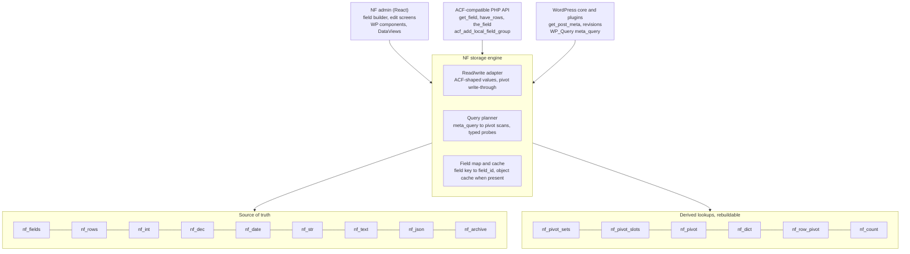
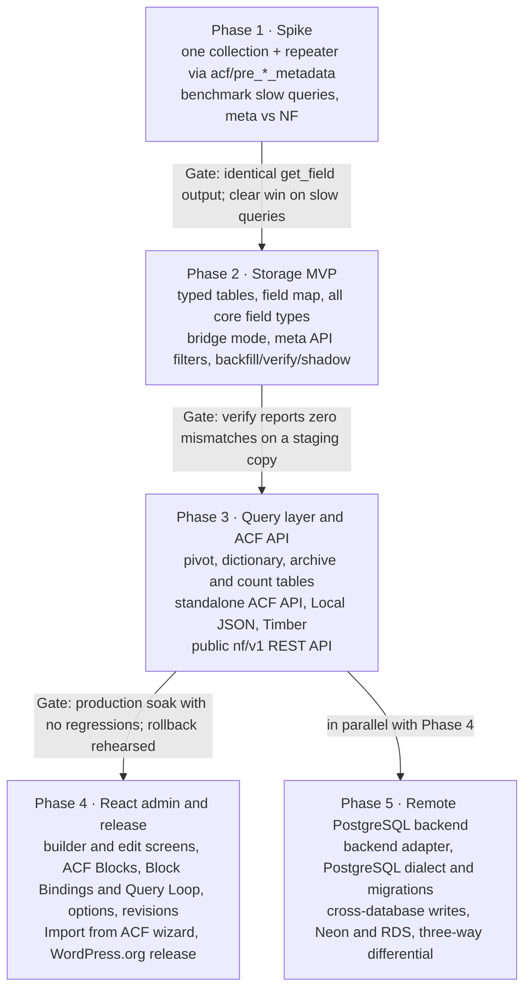

# NF — ACF Storage Analysis & Normalized Replacement Plugin

> **This note is the source of truth for the NF design** (from 2026-11-02). Change it here first, then update the published copies: the Claude doc, the Google Doc (shared with Angel as editor) and the repo's `docs/design.md`. Diagrams are redrawn here as Mermaid. Last synced to the Claude doc: 2026-11-02 (collections rename).

## Executive summary

NF should be a standalone, distributable WordPress plugin that fully replaces ACF rather than sitting underneath it. It owns three things: storage in a fixed set of typed, pivot and lookup tables, a React admin built on the packages WordPress already ships, and an ACF-compatible PHP API so themes that call `get_field()`, `have_rows()` or `acf_add_local_field_group()` keep working with ACF deactivated. ACF matters only as a migration source.

- **The real problem:** ACF writes every value, every repeater sub-field and every field-key reference as its own row in `wp_postmeta`. Filtering, sorting or searching by field value means self-joins on an unindexed `LONGTEXT` column, and relationship lookups use `LIKE '%"123"%'` against serialized arrays.
- **What is not the problem:** reading fields on a single post. WordPress primes all meta for a post in one query, so `get_field()` on a detail page is mostly PHP overhead, not SQL.
- **Existing alternatives fall short:** Hookturn's ACF Custom Database Tables, the free ACF to Custom Database Tables, and Meta Box's MB Custom Table all flatten top-level fields, but store groups/repeaters serialized or weakly and depend on their host plugin.
- **Recommended direction:** a self-contained plugin with a generic typed store (no per-content-type tables, no schema changes when fields change), a query planner that turns `meta_query` into index seeks, an ACF-compatible API and JSON format, a React admin, and an importer that migrates ACF data in place. It must run on any host: no CLI, object cache or specific database required.
- **Biggest risks:** the breadth of ACF's API (including ACF Blocks and third-party field types), code that runs raw SQL on `wp_postmeta`, and keeping the derived pivot tables in sync.

## How ACF stores data today

ACF is an entity-attribute-value (EAV) layer on top of WordPress meta: one row per value, plus one hidden row per value pointing at the field definition. Every write goes through `acf_update_metadata()`, which calls `update_metadata()` for posts, terms, users and comments, and `update_option()` for options pages ([source](https://wp-kama.com/plugin/acf/function/acf_update_metadata)).

### Storage by field type

| Field type | What lands in the meta table | Queryable? |
| --- | --- | --- |
| Text, number, date, select (single), true/false | `name` = value as string + `_name` = `field_abc123` | Only as string compare on `LONGTEXT` |
| Select (multi), checkbox | Serialized PHP array | `LIKE` only |
| Relationship, post object (multi), taxonomy, user (multi), gallery | Serialized array of IDs stored as strings | `LIKE '%"123"%'`, no index |
| Image, file, post object (single) | Attachment/post ID as string | Equality, unindexed |
| Link, Google Map | Serialized array (url/title/target, address/lat/lng) | Practically not |
| Group | `group` row (empty) + `group_sub` rows for each sub-field | Per sub-field, as above |
| Repeater | `rep` = row count, then `rep_0_sub`, `rep_1_sub`… each with its own `_` reference row | Row index lives in the key name, so no |
| Flexible content | `flex` = serialized array of layout names in order, then `flex_0_sub`… rows | No |
| Options page fields | `wp_options` rows `options_name` / `_options_name`, autoloaded by default unless the `autoload` setting is off | Load cost on every request |

### Worked example: one "Event" post

An event with 8 simple fields, a `sessions` repeater of 5 rows × 4 sub-fields, and a 6-item relationship produces:

- 8 value rows + 8 reference rows = 16
- Repeater: 1 count row + 20 value rows + 21 reference rows = 42
- Relationship: 1 serialized row + 1 reference row = 2

That is **60 `wp_postmeta` rows for one post**, about half of them `_field_xxx` pointers that ACF only needs when it cannot resolve a field by name (for example, fields registered in code with clashing names). At 20,000 events the table holds 1.2 million rows from this one post type alone.

### Why the reference rows exist

The `_name` → `field_key` row lets `get_field('name')` find the right field definition when names repeat across groups, and it is how ACF resolves sub-fields inside repeaters. A replacement must reproduce this lookup, but it can keep it in a schema map in PHP or one small table instead of one row per value per post.

## Why it's slow

The cost concentrates in listing, filtering, sorting and search queries, which turn into N-way self-joins on `wp_postmeta` filtering an unindexed column. `meta_value` is `LONGTEXT`, so MySQL cannot index it whole; value filters scan every row for that key ([Delicious Brains](https://deliciousbrains.com/?p=175781)). Core maintainers have long advised against querying by `meta_value` at all ([Trac #31595](https://core.trac.wordpress.org/ticket/31595)).

### Where the time goes

| Pattern | What MySQL does | Typical symptom |
| --- | --- | --- |
| `meta_query` with 3–5 clauses (archive filters, faceted search) | One `INNER JOIN wp_postmeta` per clause, each matching on `meta_key` index then filtering `meta_value` row by row | Seconds-long archive pages once postmeta passes \~1M rows |
| `orderby => meta_value_num` | Joins, then casts `LONGTEXT` to number for every row, filesort | Event lists sorted by date crawl |
| Relationship reverse lookup ("which events link to this venue?") | `meta_value LIKE '%"123"%'` — leading wildcard, full scan | Venue/speaker pages slow and uncachable at scale |
| Repeater sub-field filter ("events with a session on 2026-11-03") | `meta_key LIKE 'sessions_%_date'` + value compare; ACF docs suggest a `posts_where` hack | Effectively impossible to do efficiently |
| Date fields | Stored as `Ymd` strings; range filters are string compares after CAST | Correct only if every value is well-formed |
| Options pages | Many autoloaded `options_*` rows loaded on every request | Bloated `alloptions`, object-cache churn |
| Search across fields | `LIKE '%term%'` on `meta_value` | Full scans; no relevance |

### What is fine today

- **Single-post reads.** `get_post_meta()` primes the whole meta cache for a post in one query, and `update_meta_cache()` does it for a whole loop. On a detail page ACF costs mostly PHP: resolving field keys, running `acf/load_value` and `acf/format_value` per field, and rebuilding repeater arrays.
- **Writes** are many small `INSERT`/`UPDATE`s per save (60 for the example event), which is slow in bulk imports but rarely a front-end issue.

### Implication for the design

A new plugin must make value-based queries cheap: typed columns, real indexes, relationships as rows. Making single-post reads faster is a secondary goal (fewer rows, one fetch per table, cached hydrated arrays), and will not by itself justify a migration.

## Landscape: what already exists

No existing product combines full ACF compatibility, normalized repeaters/relationships and transparent `WP_Query` support; that gap is the opportunity.

| Option | Approach | Repeaters / flexible / groups | `WP_Query` meta\_query | Gaps |
| --- | --- | --- | --- | --- |
| [ACF Custom Database Tables](https://awesomeacf.pages.dev/guides/storing-acf-data-custom-database-tables) (Hookturn, paid) | Hooks ACF load/update; one table per post type, one column per field; relational fields can get their own tables; core meta storage can be switched off ([feature list](https://remarpro.com/support/topic/feature-request-custom-db-table)) | Repeater/flexible support was reported as missing by the ACF Extended author; current status needs a hands-on check | Not transparent; custom queries | Tied to ACF; closed source; schema UI only |
| [ACF to Custom Database Tables](https://pluginsdb.com/plugins/acf-to-custom-database-tables) (free + $99 Pro) | Creates a table from a field group, hooks ACF save | Pro lists repeater, flexible, group ([Pro page](https://abhisheksatre.gumroad.com/l/acf-to-custom-database-tables-pro)); reviewers found repeater did not work | No | \~600 installs, last update July 2024; bulk imports bypass the table |
| [MB Custom Table](https://docs.metabox.io/mb-custom-table/) (Meta Box) | One row per object, one column per field; also "custom models" stored fully in custom tables | Groups stored serialized in one column, so sub-fields are not queryable | Explicitly not hooked; you query IDs first, then fetch posts ([docs](https://metabox.io/docs/mb-custom-table)) | Requires migrating from ACF to Meta Box API |
| Pods (table storage) | Pods-managed tables per pod | Own relationship tables | Own query API | Different field API; not ACF-compatible |
| [Secure Custom Fields](https://developer.wordpress.org/secure-custom-fields/) (WordPress.org fork) | ACF fork since Oct 2024, same storage | Same as ACF | Same as ACF | Same storage model; worth targeting for compatibility too |

### Context worth factoring in

- ACF is owned by WP Engine; WordPress.org forked it as Secure Custom Fields in October 2024 and auto-migrated sites updating through WordPress.org ([WP Tavern](https://wptavern.com/acf-plugin-forked-to-secure-custom-fields-plugin)). Both expose the same public API and JSON format, so implementing that API once makes NF a drop-in for either.
- ACF is actively developed (6.8.9, August 2026, with V3 blocks defaulting on WordPress 7.1+) ([release notes](https://github.com/wordpress-premium/advanced-custom-fields-pro/releases/tag/v6.8.9)). NF should target the stable public API and treat newer features (V3 inline editing) as follow-ups.
- ACF 6.5 added a per-type meta instance layer (`acf_get_meta_instance()`, `acf_get_metadata_by_field()`) ([SCF reference](https://developer.wordpress.org/secure-custom-fields/code-reference/acf-meta-functions-file/)). NF uses it only in bridge mode, while ACF is still active during migration.

## Proposed architecture: a generic typed store

ACF's storage is replaced by a fixed set of tables that never change shape, whatever post types, collections or repeaters a site defines. Speed comes from three things `wp_postmeta` lacks: integer field IDs instead of string keys, one table per **data type** (not per content type) so every value sits in a properly typed column, and composite indexes that lead with the field ID and end with the object ID. Name: **Normalized Fields**; slug and text domain `normalized-fields`; NF for short in code (`NF\` namespace, `nf_` prefix).

**Terminology:** NF calls a set of fields shown together a **collection**; ACF calls the same thing a *field group*. NF's own UI, API, JSON and docs say "collection". The ACF compatibility layer keeps ACF's names unchanged (`acf_add_local_field_group()`, `acf_get_field_groups()`, `group_` keys, ACF JSON), because themes and plugins call them. In the same way, the repeater field is called **Series** in NF's UI, and each entry is a row. This doc and the code keep "repeater" as the technical name, and ACF JSON keeps `type: "repeater"`. NF has **no flexible content field**: it is an old page-building pattern that blocks now cover.



_One plugin owns the admin, the ACF-compatible API and storage; the content model lives only in `nf_fields`._

Every read and write from the NF admin, the compatibility API or core lands in the same fixed tables; the content model lives only in `nf_fields`.

### Why generic, not one table per content type

- No DDL when content models change: adding a field, a collection or a whole post type is a row in the field map, not an `ALTER TABLE`. Deploys never drift on schema, whatever the host or pipeline.
- Collections attached to many locations (posts, terms, users, options) just work.
- Proven pattern: Magento's EAV stores values in per-data-type tables (int, varchar, decimal, datetime, text) for the same reason. Its known weakness, many-join filters, is handled by the query planner below.

### Fixed schema

```sql
-- 1. Field map: every ACF field (and pseudo sub-field) gets a small integer ID
CREATE TABLE wp_nf_fields (
  field_id    INT UNSIGNED AUTO_INCREMENT PRIMARY KEY,
  field_key   VARCHAR(64)  NOT NULL UNIQUE,    -- ACF field_abc123
  field_name  VARCHAR(191) NOT NULL,
  parent_id   INT UNSIGNED NOT NULL DEFAULT 0, -- group / repeater / compound
  data_table  ENUM('int','dec','date','str','text','json','rows','none') NOT NULL,
  multi       TINYINT(1) NOT NULL DEFAULT 0,  -- several values per object/row
  row_count   BIGINT UNSIGNED NOT NULL DEFAULT 0,   -- planner statistics
  distinct_count BIGINT UNSIGNED NOT NULL DEFAULT 0,
  KEY by_name (field_name, parent_id)
);

-- 2. Structure: one row per repeater item
CREATE TABLE wp_nf_rows (
  row_id        BIGINT UNSIGNED AUTO_INCREMENT PRIMARY KEY,
  object_type   TINYINT UNSIGNED NOT NULL,   -- 1 post, 2 term, 3 user, 4 comment, 5 option
  object_id     BIGINT UNSIGNED NOT NULL,
  field_id      INT UNSIGNED NOT NULL,       -- the repeater field
  parent_row_id BIGINT UNSIGNED NOT NULL DEFAULT 0,  -- nesting
  row_order     SMALLINT UNSIGNED NOT NULL,
  KEY owner (object_type, object_id, field_id, parent_row_id, row_order)
);

-- 3-8. Typed value tables, identical skeleton, only `value` differs
CREATE TABLE wp_nf_int (
  object_type TINYINT UNSIGNED NOT NULL,
  object_id   BIGINT UNSIGNED NOT NULL,
  field_id    INT UNSIGNED NOT NULL,
  row_id      BIGINT UNSIGNED NOT NULL DEFAULT 0,   -- 0 = top level
  position    SMALLINT UNSIGNED NOT NULL DEFAULT 0, -- order for multi values
  value       BIGINT NOT NULL,
  PRIMARY KEY (object_type, object_id, field_id, row_id, position),
  KEY by_value (field_id, value, object_type, object_id)
) ENGINE=InnoDB;

-- wp_nf_dec   value DECIMAL(20,6)     + by_value index
-- wp_nf_date  value DATETIME          + by_value index
-- wp_nf_str   value VARCHAR(191)      + by_value index
-- wp_nf_text  value MEDIUMTEXT        no value index; optional FULLTEXT(value)
-- wp_nf_json  value JSON              no value index (third-party fallback only)
```

Two index facts do most of the work. The primary key clusters each object's values together, so hydrating a page of posts is one range read per table. The `by_value` key is covering: InnoDB appends the primary key columns to every secondary index, so a filter on `(field_id, value)` returns `object_id`, `row_id` and `position` without touching the table.

### Field type → table

| ACF field type | Table | How it is stored |
| --- | --- | --- |
| Text, email, URL, password, color, select (single), radio, button group | `str` | One row; values over 191 chars go to `text` with a 191-char prefix kept in `str` for equality and sorting |
| Textarea, WYSIWYG, oEmbed | `text` | One row |
| Number, range | `dec` | One row |
| True/false | `int` | 0/1 |
| Date picker, date-time picker | `date` | Real `DATETIME`; ACF's `Ymd` / return formats applied at the boundary |
| Time picker | `int` | Seconds since midnight |
| Image, file, post object, page link, user, relationship, taxonomy, gallery | `int` | One row per ID, `position` = order; target type comes from the field definition |
| Select (multi), checkbox | `str` | One row per chosen value |
| Link, Google Map | pseudo sub-fields | Decomposed: `url`/`title`/`target` in `str`; `lat`/`lng` in `dec`, `address` in `str`, `zoom` in `int` |
| Group | none | Sub-fields stored directly on the parent (same `row_id`) |
| Repeater | `rows` | One `nf_rows` row per item; sub-values carry its `row_id` |
| Flexible content | not supported | NF has no flexible content field; the importer reports these fields and does not port their collection |
| Clone | none | Resolves to the cloned fields' storage |
| Third-party / unknown | `json` | Raw value; adapters can map it to typed tables later |

For the example event: 8 simple values + 5 repeater rows + 20 sub-values + 6 relationship IDs = **39 rows instead of 60**, with no serialized data and no reference rows. Row count is not the main win; index shape is.

### How the slow queries become index seeks

```sql
-- Featured events from Nov 1, sorted by start date (archive page)
SELECT d.object_id
FROM wp_nf_date d
JOIN wp_nf_int f
  ON f.object_type = 1 AND f.object_id = d.object_id
 AND f.field_id = :is_featured AND f.row_id = 0 AND f.value = 1
WHERE d.field_id = :start_date AND d.object_type = 1
  AND d.value >= '2026-11-01'
ORDER BY d.value
LIMIT 20;
-- range scan on nf_date.by_value (already in date order, no filesort),
-- one primary-key probe into nf_int per candidate

-- Reverse relationship: which events use venue 123?
SELECT object_id FROM wp_nf_int
WHERE field_id = :venue AND value = 123;          -- one index seek

-- Repeater sub-field: events with any session on Nov 3
SELECT DISTINCT object_id FROM wp_nf_date
WHERE field_id = :session_date
  AND value >= '2026-11-03' AND value < '2026-11-04';
-- two conditions on the SAME repeater row join on row_id
```

| Query today | `wp_postmeta` | NF |
| --- | --- | --- |
| Filter by value | Join per clause, row-by-row compare on `LONGTEXT` | Range scan on a typed, covering index |
| Sort by date or number | `CAST` every row, filesort | Index order, no filesort |
| Reverse relationship | `LIKE '%"123"%'` full scan | Single index seek |
| Repeater sub-field filter | `meta_key LIKE 'rep_%_sub'` | Same as any field, plus `row_id` join |
| Load a page of 20 posts | One meta query, all keys as strings | One query per typed table (or one `UNION ALL`), already typed |

### Keeping multi-filter queries fast

- **Pivot first.** Single-valued filter and sort fields live together in one generic pivot row per object (next section), so most listings become one index range on one table with the remaining conditions checked on the same row.
- **Planner for the rest.** Multi-valued fields and repeater sub-fields still go to the typed tables. The planner orders those clauses by selectivity using `row_count` and `distinct_count` in the field map, and runs each as a semi-join probe by primary key.
- **Sort field drives when there is a `LIMIT`.** Walking the sort slot's index in order and stopping at the limit beats filtering everything then sorting.
- **ID-set caching** for repeated faceted queries in the object cache when one exists, invalidated by field ID on write.

### Pivot and lookup tables

Five more fixed tables remove the remaining costs without any per-content-type schema: a generic pivot gives every object one flat row of filterable values, a dictionary shrinks string filters to integers, and an archive moves revisions out of the typed tables. The typed tables stay the source of truth, so the pivot and dictionary are derived and can be rebuilt at any time. WooCommerce's `wc_product_meta_lookup` table is the same idea applied to price and stock.

```sql
-- Which object types get a pivot: one row per post type, taxonomy, user, options page
CREATE TABLE wp_nf_pivot_sets (
  pivot_id    SMALLINT UNSIGNED AUTO_INCREMENT PRIMARY KEY,
  object_type TINYINT UNSIGNED NOT NULL,
  subtype     VARCHAR(64) NOT NULL,          -- 'event', 'category', 'user', 'options'
  write_version BIGINT UNSIGNED NOT NULL DEFAULT 0,  -- bumped by every save, in the pivot write's transaction
  UNIQUE KEY set_key (object_type, subtype)
);

-- Which field sits in which slot, on the object pivot or a repeater's row pivot
CREATE TABLE wp_nf_pivot_slots (
  pivot_id    SMALLINT UNSIGNED NOT NULL,
  repeater_id INT UNSIGNED NOT NULL DEFAULT 0,   -- 0 = object pivot, else the repeater field
  slot        CHAR(3) NOT NULL,                  -- 'i3', 'n1', 't2', 's5', 'm1'
  field_id    INT UNSIGNED NOT NULL,
  rollup      ENUM('none','min','max','count') NOT NULL DEFAULT 'none', -- repeater sub-field rolled up
  PRIMARY KEY (pivot_id, repeater_id, slot)
);

-- One flat row per object: core columns + generic typed slots + bitmask slots
CREATE TABLE wp_nf_pivot (
  pivot_id   SMALLINT UNSIGNED NOT NULL,
  object_id  BIGINT UNSIGNED NOT NULL,
  status     TINYINT UNSIGNED NOT NULL,      -- publish, draft, private… mapped to ints
  author_id  BIGINT UNSIGNED NOT NULL DEFAULT 0,
  published  DATETIME NULL,
  menu_order INT NOT NULL DEFAULT 0,
  i1 BIGINT NULL,  -- … i8: true/false, integers, single post/user/image IDs
  n1 DECIMAL(20,6) NULL,  -- … n4: numbers, prices
  t1 DATETIME NULL,  -- … t6: dates and date-times
  s1 INT UNSIGNED NULL,  -- … s8: dictionary IDs for select, radio, short text
  m1 BIGINT UNSIGNED NOT NULL DEFAULT 0,  -- … m4: bitmasks for multi-valued fields, 64 values each
  PRIMARY KEY (pivot_id, object_id),
  KEY by_published (pivot_id, status, published),
  KEY i1 (pivot_id, i1)  -- … one (pivot_id, slot) key per typed slot; m-slots are not indexed
);

-- One flat row per repeater item
CREATE TABLE wp_nf_row_pivot (
  row_id    BIGINT UNSIGNED PRIMARY KEY,     -- same ID as nf_rows
  pivot_id  SMALLINT UNSIGNED NOT NULL,
  object_id BIGINT UNSIGNED NOT NULL,
  field_id  INT UNSIGNED NOT NULL,           -- the repeater field
  i1 BIGINT NULL,  -- … i4
  n1 DECIMAL(20,6) NULL,  -- … n2
  t1 DATETIME NULL,  -- … t4
  s1 INT UNSIGNED NULL,  -- … s4
  m1 BIGINT UNSIGNED NOT NULL DEFAULT 0,
  KEY by_object (pivot_id, object_id, field_id),
  KEY t1 (field_id, t1, object_id)  -- … one (field_id, slot, object_id) key per typed slot
);

-- Dictionary: each distinct short string stored once per field; bit = its position in an m-slot
CREATE TABLE wp_nf_dict (
  dict_id  INT UNSIGNED AUTO_INCREMENT PRIMARY KEY,
  field_id INT UNSIGNED NOT NULL,
  value    VARCHAR(191) NOT NULL,
  bit      TINYINT UNSIGNED NULL,            -- 0–63 when the field uses a bitmask slot
  UNIQUE KEY field_value (field_id, value),
  UNIQUE KEY field_bit (field_id, bit)
);

-- Revision and autosave snapshots, kept out of the typed tables
CREATE TABLE wp_nf_archive (
  object_type TINYINT UNSIGNED NOT NULL,
  object_id   BIGINT UNSIGNED NOT NULL,      -- the revision or autosave ID
  parent_id   BIGINT UNSIGNED NOT NULL,
  snapshot    LONGTEXT NOT NULL,             -- JSON of every field value
  PRIMARY KEY (object_type, object_id),
  KEY parent (object_type, parent_id)
);
```

The pivot carries 28 indexes (primary key, `by_published`, one per slot), well under InnoDB's limit of 64. A save rewrites one pivot row, and only changed slots touch their indexes.

### How the pivot is filled

- **Which fields get a slot:** top-level, single-valued fields that are filterable or sortable (true/false, number, date, select, radio, single post object, user or image). The builder marks them "filterable" by default for those types; the admin shows slot usage per object type.
- **When slots run out:** fields beyond the 26 slots stay queryable through the typed tables, and the admin warns. Multi-valued fields and repeater sub-fields get their own treatment, described below.
- **Sync:** write-through in the same transaction as every NF save. Status, author, date and menu order follow `transition_post_status` and `post_updated`. Reassigning a slot backfills one column in the background; there is no DDL.
- **Rebuild:** the Tools screen (or WP-CLI) rebuilds any pivot set from the typed tables, so a sync bug costs a rebuild, never data.
- **Revisions:** each revision or autosave becomes one `nf_archive` row. Previews and the revision compare screen read the snapshot, and restoring writes it back into the typed tables. On sites where revisions outnumber live posts, this keeps most rows out of the typed tables.

### The archive query again, on the pivot

```sql
-- Published featured events, price under 50, tagged "music",
-- with an evening session on Nov 3, sorted by first session
SELECT p.object_id
FROM wp_nf_pivot p
WHERE p.pivot_id = :event AND p.status = :publish
  AND p.i2 = 1                                    -- is_featured
  AND p.n1 < 50                                   -- price
  AND (p.m1 & :music_bit) <> 0                    -- category checkbox, bitmask slot
  AND p.t2 <  '2026-11-04' AND p.t3 >= '2026-11-03'  -- rollups: min / max session date
  AND EXISTS (SELECT 1 FROM wp_nf_row_pivot r     -- exact check, survivors only
              WHERE r.pivot_id = p.pivot_id AND r.object_id = p.object_id
                AND r.field_id = :sessions
                AND r.t1 >= '2026-11-03 18:00' AND r.t1 < '2026-11-04')
ORDER BY p.t2
LIMIT 20;
-- walks (pivot_id, t2) in order; featured, price, category and the date window are
-- checked on the same row; only rows that pass reach the one probe into their own sessions
```

| Trade-off | What fixes it |
| --- | --- |
| One join per filter clause | `nf_pivot`: filters on single-valued fields are checked on one row |
| Post type and status need a `wp_posts` join | Status, author, published date and menu order are copied into the pivot |
| Low-selectivity filters | The sort slot's index drives the scan and stops at the `LIMIT`; facet counts are one `GROUP BY` on a slot over the filtered rows |
| Typed tables grow with revisions | Revisions and autosaves live in `nf_archive`, one row each |
| Repeated strings in filters | `nf_dict` turns string filters into integer compares |
| Ad-hoc SQL and reporting | A generated read-only view per pivot set names slots after their fields (`wp_nf_v_event` with `start_date`, `price`…). Views hold no data and are recreated when slots change |

### Multi-valued and repeater filters

The remaining joins disappear for most fields by picking storage by field shape: small value sets become bitmasks on the pivot row, repeaters get a row-level pivot plus rollups on the object row, and only high-cardinality relationships still need an indexed lookup.

| Field shape | Examples | Pivot storage | Filter cost |
| --- | --- | --- | --- |
| Multi-valued, up to 64 distinct values | Checkbox, multi-select, amenities, small taxonomies | Bitmask slot `m1`–`m4`; each value's bit position lives in `nf_dict.bit` | Bitwise test on the same row: any-of `m & mask <> 0`, all-of `m & mask = mask`, none-of `m & mask = 0` |
| Multi-valued, high cardinality | Relationships to many posts, large tag sets | Stays in the typed tables (`by_value` index) | One indexed probe; the planner drives from it when the value is selective, otherwise probes survivors |
| Repeater sub-fields | Sessions, ticket tiers, opening hours | One `nf_row_pivot` row per item, plus rollup slots (min, max, count) on the object pivot | Rollups prefilter on the object row; the exact check reads only that object's own items through `by_object` |

- **Bitmasks need no index and no join.** They are checked on rows the pivot index already selected, which is where the old semi-join spent its time. A field that grows past 64 values spills into a second m-slot, or is demoted to high cardinality in the background with an admin notice.
- **Facet counts come from one query.** `SELECT m1, COUNT(*) … GROUP BY m1` over the filtered rows returns a handful of distinct masks; PHP sums the bits per value. This replaces ID-set caching for facets: counts are always live and need no invalidation.
- **Rollups make repeater filters cheap.** "Has a session on Nov 3" first checks `min_session <= Nov 3 <= max_session` on the object row. Only survivors read their own few session rows, and same-row conditions (date *and* venue on one session) are checked together without self-joins. Rollups also make "sort by next/first session" an index walk.
- **Selective repeater filters can drive.** When a repeater condition matches few rows (one date, one venue), the planner starts from `nf_row_pivot`'s `(field_id, slot, object_id)` index and probes the object pivot by primary key instead.
- **Taxonomies can join in.** Small taxonomies can optionally be mirrored into an m-slot on `set_object_terms`, so `tax_query` plus field filters run on one row instead of joining `wp_term_relationships`.
- **MySQL 8.0.17+ bonus.** Where the server supports multi-valued indexes, high-cardinality relationships can also be stored as a JSON array slot with a multi-valued index (`MEMBER OF`, `JSON_OVERLAPS`). MariaDB and MySQL 5.7 keep the typed-table probe, so this stays an optional accelerator.
- **Beyond \~1M objects per type**, the next step is a postings table of compressed bitmaps per value, intersected in PHP. It is not needed for typical WordPress catalogues and stays out of the core design.

### Worked scenario: a large repeater

Assumptions: an `event` post type with 10,000 posts, each with a `sessions` repeater of **50 rows × 15 sub-fields** (4 text, 2 textarea, 2 number, 2 date, 2 true/false, 1 image, 1 select, 1 relationship with 3 IDs). Sizes are estimates including InnoDB row and index overhead; the Phase 1 benchmark should confirm them.

| Metric | ACF (`wp_postmeta`) | NF (normalized) | NF (packed repeater) |
| --- | --- | --- | --- |
| Rows per post | 1,502 (750 values + 750 `_field_key` refs + count + its ref) | 950 (50 structure + 850 typed values + 50 row-pivot) | 51 (1 JSON row + 50 row-pivot) |
| Rows site-wide | 15.0M | 9.5M | 0.5M |
| Size per post / site-wide | \~246 KB / \~2.35 GB | \~146 KB / \~1.39 GB | \~70 KB / \~0.7 GB |
| Listing page of 20 posts | WordPress primes **all** meta: \~30,000 rows, \~3 MB, even if the card shows only title and date | Pivot only: 20 rows; repeater untouched unless the template asks for it | Same as normalized |
| Detail page (one post) | 1 query returning 1,502 rows; then \~750 `get_sub_field` lookups, each through `load_value`/`format_value` | \~6 queries (one per typed table, or one `UNION ALL`) returning 900 typed rows, hydrated once into the ACF array shape | 1 query, 1 row, decoded once |
| Save the post | \~1,500 `update_metadata()` calls, each a read plus a write: \~3,000 queries | Row diff, then a few multi-row `INSERT … ON DUPLICATE KEY UPDATE` in one transaction | 1 row write + row-pivot diff |
| Reorder (move row 1 to the end) | 750 value rewrites (row index is in the key name) | 50 `row_order` updates, one statement | 1 row rewrite |
| Delete a middle row | \~375 key renames + 30 deletes | 1 structure row + \~19 value rows deleted | 1 row rewrite |
| Filter: events with a session on Nov 3 | `meta_key LIKE 'sessions_%_date'` matches every sub-field key with that prefix: \~7.5M index entries scanned, then a string compare | Rollup prefilter on the pivot row, then a `(field_id, t1)` range on `nf_row_pivot`: only matching rows | Same as normalized (row-pivot still filled) |
| Admin edit form | \~750 server-rendered inputs posted as form fields; large repeaters can hit PHP's `max_input_vars` (default 1,000) and silently drop values | React form saves JSON over REST, so `max_input_vars` does not apply; rows render lazily and paginate | Same |

### What this means

- **Normalized NF cuts storage by about 40%, not by an order of magnitude.** Every sub-value is still a row. The decisive wins are elsewhere: listings stop loading repeaters they do not show, edits touch rows instead of renaming keys, and sub-field filters become index ranges.
- **The worst ACF cost is invisible:** archive pages load every repeater value of every post on the page, because core primes all meta per post. At 50 × 15 that is \~3 MB per request before any field is used.
- **Packed storage for display-only repeaters.** Most large repeaters (schedules, specs, FAQs) are only rendered, never filtered by every sub-field. A per-repeater setting stores the rows as one JSON value in `nf_json`, while sub-fields marked filterable still go to `nf_row_pivot` and rollups. That brings the example to \~51 rows per post, makes reads a single row, and keeps queries on the fields that matter. Normalized stays the default; the builder suggests packed above \~20 rows × 10 sub-fields.
- **Rows-per-post is the metric to watch,** not sub-field count. The admin health screen shows the largest repeaters per post type and their storage mode.

### Sorting repeater rows

Repeaters (Series in the UI) get a sort setting, a PHP hook and a toolbar action in the admin. Rows can be ordered alphabetically by a sub-field, by a date sub-field, or by the `post_date` of a linked post, either once by the editor or automatically on every save.

**Field setting** (stored in the field's JSON under an `nf_sort` key, which ACF ignores, so collections still round-trip through ACF JSON):

```php
'nf_sort' => [
    'mode'    => 'on_save',          // manual | on_save | on_read
    'by'      => 'sub_field:title',  // sub_field:<name> | post_date:<sub_field> | callback
    'order'   => 'asc',              // asc | desc
    'compare' => 'locale',           // locale | natural | binary
    'empty'   => 'last',             // first | last
],
```

| Mode | When it sorts | Cost | Drag-and-drop in admin |
| --- | --- | --- | --- |
| `manual` (default) | Only when an editor clicks Sort | One `row_order` rewrite per click | On |
| `on_save` | Every save, then the order is stored | One statement updating `row_order` (or one JSON rewrite when packed); reads stay a plain index scan | Off; the toolbar shows "Sorted by Title, A–Z" |
| `on_read` | When the value is loaded; stored order untouched | Sort in PHP on hydration, per request, cached with the object | On; front end ignores manual order |

**Sort keys**

- **Alphabetical by a sub-field:** text, select, radio. `locale` uses PHP's `intl` `Collator` with the site locale when available (correct for accented and non-Latin alphabets), falling back to `strnatcasecmp`; the admin uses `Intl.Collator` so the preview matches the server.
- **By a date sub-field:** date and date-time sub-fields, compared as real dates from `nf_date`.
- **By a linked post's `post_date`:** for post object or relationship sub-fields. NF fetches the dates in one `SELECT ID, post_date FROM wp_posts WHERE ID IN (…)`. With `on_save`, a stored order can go stale when the linked post's date changes, so NF listens to `post_updated`, finds the parents through the `by_value` reverse index on `nf_int`, and re-sorts them in the background.
- **Ties** fall back to the previous row order, so sorting is stable.

**PHP hooks**

```php
// Change or replace the sort for any repeater; also /name=sessions and /key=field_abc123 variants
apply_filters( 'nf/repeater/sort_rows', array $rows, array $field, $object_id, array $sort );

// Register a custom sort key that appears in the field settings and the toolbar
nf_register_row_sorter( 'price_then_title', [
    'label'   => __( 'Price, then title' ),
    'compare' => fn( $a, $b ) => [ $a['price'], $a['title'] ] <=> [ $b['price'], $b['title'] ],
] );

// Fires after rows were re-sorted and stored (on_save or editor action)
do_action( 'nf/repeater/sorted', array $field, $object_id, array $new_order );
```

Templates can sort per call without touching stored order: `get_field( 'sessions', $id, true, [ 'sort' => 'title' ] )` and in Timber `post.meta('sessions', { sort: 'post_date:speaker', order: 'desc' })`. `have_rows()` follows the field's setting.

**Admin interface**

- A **Sort** `DropdownMenu` in the Series toolbar lists A–Z and Z–A for each text sub-field, Oldest and Newest for each date or linked post, and any registered sorters. Choosing one reorders rows in place with an undo snackbar; the editor can keep dragging afterwards.
- When the field uses `on_save`, the toolbar shows the active rule instead, drag handles are hidden, and new rows drop into their sorted position.
- In the field builder, the repeater's settings panel has a **Row order** section (mode, sort key, direction, empty values) built with DataForm.
- JS sorters register through `@wordpress/hooks` (`addFilter( 'nf.repeater.sortOptions', … )`). The server always re-applies the PHP comparator on save, so a client-only sorter can never produce an order the server disagrees with.

## Benchmark: query speed, ACF vs NF

Measured, not estimated: the same synthetic event catalogue was loaded into ACF-style `wp_postmeta` and into NF's tables, and each query ran in both. For every filter query, NF returned exactly the same post IDs as ACF. At 100,000 posts NF was **4× to 3,000× faster than ACF with performance indexes**, and **2× to 9,000× faster than stock ACF**; the gap grows with data size.

**Setup.** MariaDB 10.11, 2 vCPU, 3 GB buffer pool, warm cache (all data in memory, the best case for ACF; on disk the gap widens). Each event has 17 top-level fields (date, price, capacity, featured, venue, a 12-value category checkbox, a 1–4 artist relationship, 10 text fields) and a 5-row × 3-sub-field `sessions` repeater: 66 `wp_postmeta` rows per post. ACF queries are written the way `WP_Query` `meta_query` generates them (`CAST`, `SQL_CALC_FOUND_ROWS`, `LIKE` on serialized arrays). Times are the median of 7 runs. **ACF tuned** adds the indexes that performance plugins such as Index WP MySQL For Speed install: primary key `(post_id, meta_key, meta_id)` and `(meta_key, meta_value(32), post_id)`. A 300,000-post run was stopped early because stock ACF queries were taking too long.

### 100,000 posts (6.6M `wp_postmeta` rows)

| Query | ACF stock | ACF tuned | NF | NF vs tuned |
| --- | --- | --- | --- | --- |
| Archive: featured, upcoming, by date, page 1 + total | 11,051 ms | 54 ms | 13.9 ms | 4× |
| Multi-filter: price, capacity, category, date range + total | 10,708 ms | 575 ms | 24.4 ms | 24× |
| Reverse relationship: events featuring artist 123 | 218 ms | 417 ms | 0.8 ms | 520× |
| Repeater sub-field: a session on Nov 3 after 18:00 | 7,131 ms | 2,478 ms | 0.8 ms | 3,180× |
| Facet counts: categories for 2026 events | 7,973 ms | 400 ms | 24.6 ms | 16× |
| Deep page: all events by date, page 50 + total | 327 ms | 438 ms | 16.1 ms | 27× |
| Listing load: field data for 20 cards | 3.9 ms | 5.9 ms | 0.8 ms | 7× |
| Detail page: all fields of one post | 0.66 ms | 0.67 ms | 0.36 ms | 2× |

Rows read per query (InnoDB handler reads) show why: the repeater filter reads 6.1M rows in both ACF variants against 204 in NF; the multi-filter reads 9.2M (stock) and 364k (tuned) against 101k.

### 10,000 posts (660k `wp_postmeta` rows)

| Query | ACF stock | ACF tuned | NF |
| --- | --- | --- | --- |
| Archive + total | 974 ms | 3.4 ms | 2.3 ms |
| Multi-filter + total | 1,046 ms | 49 ms | 3.1 ms |
| Reverse relationship | 21 ms | 26 ms | 0.14 ms |
| Repeater sub-field | 737 ms | 230 ms | 0.16 ms |
| Facet counts | 854 ms | 31 ms | 3.1 ms |
| Deep page + total | 30 ms | 26 ms | 2.5 ms |
| Listing load (20 cards) | 4.2 ms | 6.3 ms | 1.0 ms |
| Detail page | 0.61 ms | 0.77 ms | 0.55 ms |

### What the numbers say

- **Stock ACF scales linearly and badly.** Ten times the data made every filter query about 11× slower, crossing 7–11 seconds at 100k posts. The cause is the join through the `post_id` index, which reads every one of a post's 66 meta rows for each candidate.
- **Index tuning fixes simple filters but not the structural cases.** Tuned ACF is close to NF on the single-condition archive (4×), but repeater sub-fields still scan every `sessions_*` key (2.5 s), and serialized relationships still need `LIKE '%"123"%'`, which no index can serve; the tuned index even made that query slower.
- **NF's index-seek queries stay flat.** Reverse relationships and repeater filters stayed under 1 ms at both sizes; only the matching rows are read.
- **NF's remaining linear cost is counting.** Archive, multi-filter, facet and deep-page queries grew 6–8× with 10× data because the pagination total and facet `GROUP BY` read every matching pivot row (the archive count reads 100k rows to return 3,813). The counting tier below removes most of that cost.
- **Storage at 100k:** ACF's meta used 1,222 MB for 6.55M rows; all NF tables together used 667 MB for 4.6M rows, including the pivot and row pivot.
- **Single-post reads barely change** (0.66 → 0.36 ms), as the analysis predicted: NF's case rests on listings, filters and repeaters, not on detail pages.

### Counting tier

Page totals and facet counts get their own small layer, so a listing no longer re-counts every matching row on each request. Three mechanisms cover different query shapes, and the planner picks one per count:

1. **Count rollup (`nf_count`)** for the common shapes: total, or one field value or category, within a date range and status. Exact, maintained on every save.
2. **Versioned count cache** for arbitrary multi-filter combinations. Exact while nothing in that object type has changed.
3. **Capped counts** as the fallback when neither applies: count up to 1,001 and show "1,000+".

```sql
-- Fixed schema, like every other NF table
CREATE TABLE wp_nf_count (
  pivot_id SMALLINT UNSIGNED NOT NULL,
  status   TINYINT UNSIGNED NOT NULL,
  dim      CHAR(3) NOT NULL,       -- '*' = all, or a slot: 'i1', 's3', 'm1'
  val      BIGINT NOT NULL,        -- slot value, or bit number for a bitmask slot
  day      DATE NOT NULL,          -- from the pivot set's count date slot (default: published)
  n        INT UNSIGNED NOT NULL,
  PRIMARY KEY (pivot_id, status, dim, val, day),
  KEY by_day (pivot_id, status, dim, day, val, n)   -- covering: facet counts over a date range
);
```

- **What gets rolled up:** the `*` total, every boolean, select and dictionary slot, and every bit of every bitmask slot, each per day. Numbers, relationships and free text are excluded, since their values are too many to pre-count. At 100k posts the table held 44.5k rows.
- **Maintenance:** on save, NF subtracts one from the post's old (dimension, value, day) cells and adds one to the new ones, in the same transaction as the pivot write. Status changes and trashing move counts between statuses. A rebuild from the pivot is one `INSERT … SELECT` per dimension.
- **Count cache:** the key is a hash of the normalized filter. Each pivot set has a write version that every save bumps, so a cached count is valid exactly as long as nothing in that post type changed. It lives in the object cache when one exists, otherwise in a small `nf_count_cache` table. The version is the `write_version` column on `nf_pivot_sets`, bumped in the same transaction as the pivot write. Rows in `nf_count_cache` expire after a day (filter `nf/count_cache/ttl`), and a daily background job deletes expired rows and rows from older versions. Anonymous requests read the table but never write to it: without this rule, varying filters from outside would grow it through plain GETs. To keep the fallback useful, a background job recomputes the filter combinations a collection declares after saves; other combinations pay the live count.
- **Capped counts:** available per query (`'nf_count' => 'exact' | 'capped' | 'none'`), mirroring `WP_Query`'s `no_found_rows`. Pagination then shows previous/next and "1,000+ results".
- **Planner index hints:** slot keys become `(pivot_id, status, slot)`. In testing, MariaDB ignored them and scanned the pivot by primary key; forcing the slot index halved the archive count (15.2 → 7.8 ms). NF's planner uses its own field statistics to add `FORCE INDEX` when a slot is selective.

**Measured at 100,000 posts** (same dataset as the benchmark; rollup results verified identical to live counts):

| Count | Live `COUNT(*)` today | With the counting tier | Gain |
| --- | --- | --- | --- |
| Archive total: featured, upcoming | 15.2 ms, 100k rows read | 0.42 ms from `nf_count`, 764 rows | 36× |
| Facet counts: 12 categories, 2026 events | 21.1 ms, 119k rows | 2.1 ms from `nf_count` (day-first key), 8.8k rows | 10× |
| All-events total (deep pagination) | \~16 ms | 0.63 ms from `nf_count` | 25× |
| Multi-filter total (price, capacity, category, year) | 21.8 ms | 0.09 ms on a cache hit; 21.8 ms on a miss | 240× on hit |
| Archive total, capped at 1,001 | 15.2 ms | 4.3 ms | 3.5× |
| Cost added to each save | n/a | 0.74 ms (6 upserts, one transaction) | n/a |

Two limits remain. A capped count does not help when fewer rows match than the cap (the multi-filter query matched 729, so it still read all 100k). And facet counts inside an already-filtered result (category counts among events under 50) can only come from the cache or a live `GROUP BY`; the rollup covers one filter plus a date range.

## ACF-compatible API

NF ships its own implementation of ACF's public PHP API, hooks and JSON format, so a theme written for ACF runs unchanged with ACF deactivated. Values come back in exactly the shapes ACF returns: the same return formats, the same `$post_id` conventions (`'option'`, `'term_12'`, `'user_3'`, `'comment_5'`, `'options_fr'`), the same `format_value` flag.

### Two modes

- **Bridge mode (ACF active, migration only).** ACF keeps its admin; NF takes over storage through `acf/pre_load_metadata`, `acf/pre_update_metadata`, `acf/pre_delete_metadata` and, on ACF 6.5+, the by-field meta layer. This is how data is backfilled and verified without touching the theme.
- **Standalone mode (ACF inactive).** NF defines the `get_field()` family and `acf_*` registration functions itself, each guarded by `function_exists()`, loads collections from its own store and JSON, and renders its own admin. This is the target state.

### Surface NF implements

| Surface | What NF provides |
| --- | --- |
| Template functions: `get_field`, `the_field`, `get_fields`, `get_field_object`, `have_rows`, `the_row`, `get_sub_field`, `get_row_index`, `update_field`, `update_sub_field`, `add_row`, `update_row`, `delete_row`, `delete_field` | Same signatures and return values, served from the hydrated object cache |
| Registration: `acf_add_local_field_group`, `acf_add_local_field`, `acf_add_options_page`, `acf_add_options_sub_page` | Parsed into `nf_fields`; field keys preserved so existing data and JSON still match |
| Local JSON: `acf-json` folders, `acf/settings/save_json` and `load_json` | Read and written in ACF's JSON format, so collections move between ACF (as field groups) and NF in both directions |
| Hooks: `acf/init`, `acf/load_field`, `acf/prepare_field`, `acf/load_value`, `acf/format_value`, `acf/update_value`, `acf/validate_value`, `acf/save_post` (with `/name=`, `/key=`, `/type=` variants) | Fired at the same points with the same arguments |
| ACF Blocks: `acf_register_block_type()` and block.json `acf` config | Blocks registered from the same config, rendered by their `render_template` / `render_callback` with `get_field()` reading block context; editing in NF's React inspector panel. V3 inline editing is a later phase |
| `acf_form()` / `acf_form_head()` front-end forms | Server-rendered form with a small script; later phase. Guest submissions need `nf_allow_guest_forms` and go through NF's own validation and nonce checks |
| REST `acf` field on core endpoints | Registered with the same shape; WPGraphQL support through an adapter later |
| Custom field types (`acf_register_field_type()`, `acf_field` subclasses) | Storage works through the `json` table; their jQuery admin UIs do not run in the React admin, so each needs an NF adapter. The biggest compatibility gap |
| Core meta API (`get_post_meta()` on ACF keys) and `WP_Query` `meta_query` | Core `get_{type}_metadata` filters and `get_meta_sql` translation, as described in the architecture |
| Raw SQL against `wp_postmeta` | Not interceptable; found by audit |

### Query API

NF should ship a fluent query builder, but not an ORM with its own model objects. The builder resolves fields against the pivot, row pivot and typed tables, then hands the matching IDs back to WordPress, so every result is a native `WP_Post`, `WP_Term` or `WP_User`, and `get_posts()`, `WP_Query`, the loop, template tags and Timber all keep working unchanged.

The entry points are plain functions, like the rest of NF's public API: `nf_query()` returns the chainable builder and `nf_options()` reads options pages (D-15). `NF::query()` and `NF::options()` remain as aliases for code that prefers the static form.

Why not a separate ORM: model objects that bypass `WP_Post` break template tags, Timber's class map, the `the_posts` filter, other plugins' hooks and core's post cache, and duplicate the hydration WordPress already does well. The slow part is only the field filtering and sorting; that is the one piece NF replaces.

#### The builder

```php
$events = nf_query( 'event' )                     // post type, taxonomy ('term:genre') or 'user'
    ->status( 'publish' )
    ->where( 'is_featured', true )
    ->where( 'start_date', '>=', '2026-11-01' )
    ->where( 'price', '<', 50 )
    ->whereAny( 'category', [ 'music', 'food' ] )        // bitmask slot: one bitwise check
    ->whereRelated( 'artists', 123 )                     // index seek on nf_int
    ->whereRow( 'sessions', fn( $row ) => $row           // conditions on the SAME repeater row
        ->where( 'session_date', 'between', [ '2026-11-03 18:00', '2026-11-04' ] )
        ->where( 'speaker', 42 ) )
    ->search( 'jazz' )                                   // core post search, combined by the planner
    ->tax( 'region', 'varna' )                           // core taxonomy, or a mirrored bitmask slot
    ->orderBy( 'start_date' )->orderBy( 'title' )
    ->with( [ 'artists', 'venue' ] )                     // eager-load related posts and their fields
    ->paginate( 20, $page, count: 'exact' );             // exact | capped | none (counting tier)
```

**Results, all native:**

| Method | Returns | How |
| --- | --- | --- |
| `->ids()` | `int[]` | Pivot query only; no `wp_posts` read at all |
| `->posts()` | `WP_Post[]` | IDs, then `_prime_post_caches()` in one query, order preserved |
| `->wp_query()` | a real `WP_Query` | Runs through `posts_pre_query` (below), so `found_posts`, `max_num_pages`, `have_posts()`, the loop and pagination functions work |
| `->timber()` | `Timber\PostCollectionInterface` | `Timber::get_posts()` with the same IDs; Timber's class map applies |
| `->values( [ 'start_date', 'price' ] )` | plain arrays | Projection straight from the pivot, typed and ACF-formatted; for REST, AJAX and exports, no `WP_Post` built |
| `->count()`, `->facets( [ 'category', 'venue' ] )` | `int`, `array` | Served by the counting tier |
| `->toSql()`, `->explain()` | `string`, `array` | The compiled SQL and the planner's choice, for debugging |

**Eager loading.** Each result set primes field data for all its IDs in one query per typed table, so `get_field()` and `post.meta()` inside the loop never hit the database. `with()` also loads related posts and their fields in one batch, so 20 cards with an artist each cost two extra queries, not 20.

#### Native WordPress queries, no builder needed

The same compiler sits behind `WP_Query`, so existing code and Timber get the speed-up without changes:

1. **Full short-circuit (`posts_pre_query`).** When every condition is something NF can answer (field filters, status, type, date, author, mirrored taxonomies), NF compiles the query to the pivot, sets `found_posts` and `max_num_pages` from the counting tier, and returns the IDs. Core skips its own SQL; the result is a normal `WP_Query`.
2. **Single-join mode (`posts_clauses`).** When the query also uses things NF does not own (full-text `s`, complex `tax_query`, `post__not_in`, third-party clauses), NF leaves core in charge and replaces the N `wp_postmeta` joins with **one** join to `nf_pivot` plus slot conditions and `ORDER BY` a slot. Repeater and relationship conditions become `EXISTS` subqueries on the indexed tables.
3. **Untranslatable clauses** (a meta key NF does not manage, `REGEXP` on a value) pass through to core untouched.

NF also accepts its own argument inside any `WP_Query`, `get_posts()` or `Timber::get_posts()` call, for conditions `meta_query` cannot express:

```php
$posts = Timber::get_posts( [
    'post_type'      => 'event',
    'posts_per_page' => 20,
    'meta_query'     => [ [ 'key' => 'is_featured', 'value' => 1 ] ],   // translated automatically
    'nf'             => [
        'row'     => [ 'sessions' => [ [ 'session_date', 'between', [ '2026-11-03', '2026-11-04' ] ] ] ],
        'related' => [ 'artists' => 123 ],
        'orderby' => [ 'start_date' => 'ASC' ],
        'count'   => 'capped',
    ],
] );
```

In Twig, `` then works as with any Timber collection, and `event.meta('sessions')` is already hydrated.

#### Rules that keep it safe

- `suppress_filters`, `fields => ids`, `no_found_rows`, `cache_results` and `update_post_meta_cache` are honoured; with NF active, priming core's `wp_postmeta` cache is skipped for NF-owned keys.
- Private and draft posts follow the same capability checks as core, because status and author live in the pivot and the current user's permissions are applied before the query.
- `toSql()` and the Query Monitor panel show which mode ran (short-circuit, single join, pass-through), so slow queries are easy to trace.
- The builder's public surface is versioned and documented as NF's main developer API; it compiles to the same SQL as the `WP_Query` translation, so both paths are tested together.

#### Pagination parity

Pagination behaves exactly as core's. NF changes how the page of IDs and the total are computed, never what they mean. The rules:

1. **Same arguments, same meaning.**
   - `paged`, `page` (static front page), `posts_per_page`, `posts_per_archive_page`, `offset`, `nopaging` and `posts_per_page => -1` work as in core.
   - `offset` overrides `paged`, as it does in core.
   - `-1` and `nopaging` mean no `LIMIT` and no count query.
   - Sticky posts are left to core: it adds them to page 1 of the home query after NF returns its IDs.
2. **The total goes through core's path.**
   - In short-circuit mode, NF short-circuits `found_posts_query` and supplies the count through the `found_posts` filter at an early priority. It does not overwrite the property.
   - Core then computes `max_num_pages`, and other `found_posts` filters (including the usual "subtract the offset" fix) run as they always have.
   - `no_found_rows` skips the count entirely.
3. **Past the last page means 404, as in core.** A `/page/N/` beyond `max_num_pages` returns no posts, so `WP::handle_404()` behaves as it would without NF. The page of IDs and the total are read at the same pivot write version, so they can never disagree.
4. **Capped counts in templates.**
   - With `count: 'capped'`, `found_posts` is the cap plus one (1,001 by default), and the query carries `$query->nf_count_capped = true`.
   - `paginate_links()` shows pages up to the cap, plus "next".
   - If a request asks for a page beyond the cap, NF runs an exact count for that request only, so a deep link never gets a false 404.
   - Timber's pagination and the REST headers get the same flag.
5. **Deep pages stay cheap.**
   - Past a threshold (default: offset over 1,000 rows), the planner uses a deferred join: it reads only IDs from the covering slot index up to the offset, then loads the page.
   - Infinite scroll, "load more" and REST clients can use seek pagination instead: `->after( $cursor )`, with an opaque cursor built from the sort key and the ID.
   - `->chunk()` already uses this.
6. **REST collections report totals as core does:** `X-WP-Total` and `X-WP-TotalPages`, plus `X-NF-Total-Capped: 1` when the count is capped.

**Differential cases (WP 1.3 for the spike queries, WP 3.3 in full):**
- `paged` 1, 2 and the last page;
- the page after the last page (expects a 404);
- `offset` with and without `paged`;
- `posts_per_page => -1` and `nopaging`;
- `no_found_rows`;
- sticky posts on the home page;
- `posts_per_archive_page`;
- a static front page using `page`;
- capped counts below, at and above the cap;
- a deep offset (page 5,000);
- a cursor walk that matches the offset walk ID for ID.

Every case must return the same IDs, order, `found_posts` and `max_num_pages` as core on `wp_postmeta`.

#### Examples

Pseudo-code: method names show the intended shape of the API and may change during the build.

**1. Event archive with pagination, rendered by Timber**

```php
// archive-event.php
$page   = max( 1, get_query_var( 'paged' ) );
$events = nf_query( 'event' )
    ->status( 'publish' )
    ->where( 'start_date', '>=', 'today' )
    ->orderBy( 'start_date' )
    ->with( [ 'venue' ] )                       // venue posts + their fields in one batch
    ->paginate( 20, $page )
    ->timber();                                  // native Timber collection

Timber::render( 'archive-event.twig', [ 'events' => $events ] );
```

```twig

  <h3>{{ event.title }}</h3>
  <p>{{ event.meta('start_date') }} · {{ event.meta('venue').title }}</p>

{{ include('partials/pagination.twig', { pagination: events.pagination }) }}
```

**2. Faceted search page built from the request**

```php
$q = nf_query( 'event' )->status( 'publish' );

if ( $cats = $request->get( 'category' ) ) $q->whereAny( 'category', $cats );
if ( $max  = $request->get( 'max_price' ) ) $q->where( 'price', '<=', (float) $max );
if ( $from = $request->get( 'from' ) )      $q->where( 'start_date', '>=', $from );
if ( $term = $request->get( 's' ) )         $q->search( $term );

$results = $q->orderBy( $request->get( 'sort', 'start_date' ) )
             ->paginate( 24, $request->get( 'page', 1 ), count: 'capped' );

$facets = $q->facets( [ 'category', 'venue', 'price' => [ 0, 25, 50, 100 ] ] );
// [ 'category' => [ 'music' => 412, 'food' => 97, … ],
//   'venue'    => [ 18 => 33, 27 => 12, … ],
//   'price'    => [ '0-25' => 120, '25-50' => 301, … ] ]
```

**3. Reverse relationship: an artist's page**

```php
// single-artist.php: every upcoming event that lists this artist
$events = nf_query( 'event' )
    ->whereRelated( 'artists', get_the_ID() )
    ->where( 'start_date', '>=', 'today' )
    ->orderBy( 'start_date' )
    ->posts();                                   // WP_Post[]
```

**4. Repeater rows: sessions happening tonight, two conditions on the same row**

```php
$tonight = nf_query( 'event' )
    ->whereRow( 'sessions', fn( $row ) => $row
        ->where( 'session_date', 'between', [ 'today 18:00', 'tomorrow 00:00' ] )
        ->where( 'room', 'main-stage' ) )
    ->orderByRow( 'sessions', 'session_date' )   // sort by the matching row, not the post
    ->limit( 10 )
    ->timber();
```

**5. Related events: same category, excluding the current one**

```php
$related = nf_query( 'event' )
    ->whereAny( 'category', get_field( 'category' ) )
    ->where( 'start_date', '>=', 'today' )
    ->exclude( get_the_ID() )
    ->orderBy( 'start_date' )
    ->limit( 4 )
    ->count( 'none' )                            // no total needed
    ->posts();
```

**6. JSON endpoint without building WP\_Post objects**

```php
register_rest_route( 'site/v1', '/events', [
    'callback' => fn( $req ) => nf_query( 'event' )
        ->status( 'publish' )
        ->where( 'start_date', '>=', 'today' )
        ->orderBy( 'start_date' )
        ->limit( 100 )
        ->values( [ 'id', 'title', 'start_date', 'price', 'venue.title' ] ),
        // [ [ 'id' => 812, 'title' => 'Jazz Night', 'start_date' => '2026-11-03', 'price' => 25.0, 'venue.title' => 'Festival Hall' ], … ]
] );
```

**7. Terms, users and options use the same builder**

```php
$genres  = nf_query( 'term:genre' )->where( 'featured', true )->orderBy( 'sort_order' )->terms();   // WP_Term[]
$editors = nf_query( 'user' )->where( 'team', 'editorial' )->whereAny( 'languages', [ 'en', 'bg' ] )->users(); // WP_User[]
$banner  = nf_options( 'site-settings' )->get( 'banner' );                                              // like get_field( 'banner', 'option' )
```

**8. Large exports in chunks**

```php
nf_query( 'event' )
    ->where( 'start_date', 'between', [ '2026-01-01', '2026-12-31' ] )
    ->orderBy( 'id' )
    ->chunk( 500, function ( array $rows ) use ( $csv ) {      // keyset pagination, constant memory
        foreach ( $rows as $row ) fputcsv( $csv, $row );
    }, fields: [ 'id', 'title', 'start_date', 'price', 'category' ] );
```

**9. Plain WP\_Query and Timber, no builder: translated automatically**

```php
// Existing theme code keeps working; NF short-circuits it through posts_pre_query
$query = new WP_Query( [
    'post_type'  => 'event',
    'meta_key'   => 'start_date',
    'orderby'    => 'meta_value',
    'order'      => 'ASC',
    'meta_query' => [
        [ 'key' => 'is_featured', 'value' => 1 ],
        [ 'key' => 'start_date', 'value' => date( 'Ymd' ), 'compare' => '>=', 'type' => 'DATE' ],
    ],
] );

// Same thing with NF-only conditions added
$posts = Timber::get_posts( [
    'post_type' => 'event',
    'nf'        => [
        'where'   => [ [ 'price', '<', 50 ] ],
        'any'     => [ 'category' => [ 'music' ] ],
        'row'     => [ 'sessions' => [ [ 'speaker', '=', 42 ] ] ],
        'related' => [ 'artists' => 123 ],
        'count'   => 'capped',
    ],
] );
```

**10. Debugging: see what NF compiled**

```php
$q = nf_query( 'event' )->where( 'is_featured', true )->where( 'start_date', '>=', '2026-11-01' )->orderBy( 'start_date' )->limit( 20 );

$q->toSql();
// SELECT object_id FROM wp_nf_pivot FORCE INDEX (i1)
// WHERE pivot_id = 1 AND status = 1 AND i1 = 1 AND t1 >= '2026-11-01'
// ORDER BY t1 LIMIT 20

$q->explain();
// [ 'mode' => 'pivot', 'driver' => 'i1 (is_featured)', 'count' => 'rollup:i1×day',
//   'estimated_rows' => 3813, 'joins' => 0 ]
```

### Loading data: N+1, eager loading and loops

The goal is a constant number of queries per listing, however many items it shows, without asking theme developers to change anything. Three rules get there: every object NF returns remembers the result set it came from, each field loads **for the whole set** the first time any item touches it, and every value comes back as the plain PHP data ACF would have returned, so native loops, Timber and any other code can use it directly.

#### Where N+1 comes from today

| Pattern | ACF today, 20 cards | Why |
| --- | --- | --- |
| Field values of each post | 1 query (core primes all meta) | Already batched, but loads every field, including repeaters nobody renders |
| Post object / relationship targets | 20+ queries | `get_field()` fetches each card's related posts separately, then their meta |
| Image and file fields | 40+ queries | Each attachment needs its post and its `_wp_attachment_metadata` |
| Fields of related posts (`artist.photo`) | 20 × n queries | One lookup per related post, then per attachment |
| Repeater sub-field relations (`sessions.speaker`) | 20 × rows queries | One lookup per row |
| Posts fetched one by one (`get_post()` / `Timber::get_post()` in a loop) | N queries for everything above | No result set exists for core to prime |

#### Result-set registry

- Every NF result set (the builder, a translated `WP_Query`, `get_posts()`, `Timber::get_posts()`) registers its IDs in a request-level registry keyed by **post ID**, never by attaching data to `WP_Post` objects. Core shares one `WP_Post` instance per ID and dynamic properties are deprecated in PHP 8.2+, so the registry stays outside the object.
- Queries NF does not translate still register: NF keeps a weak reference to the `WP_Query` from `posts_pre_query` (which core fires even with `suppress_filters`, as in `get_posts()`) and reads its `posts` when a field is first accessed.
- A post that appears in several sets is batched with the most recent set that has not loaded that field yet. Sets are capped (500 IDs per batch) and larger sets load in chunks.

#### Lazy per field, eager per set

| Data | When it loads | Queries for the whole set |
| --- | --- | --- |
| Pivot-backed fields (dates, numbers, booleans, selects) | With the query itself | 0 extra |
| Other scalar fields, text, WYSIWYG | First access to **any** field of that collection on any item | 1 per typed table touched |
| Repeaters | First access to that field on any item | 1 (rows) + 1 per typed table of its sub-fields; packed repeaters 1 |
| Relationship, post object, user, taxonomy | First access | 1 for the IDs + 1 to prime targets (`_prime_post_caches`, `cache_users`, `_prime_term_caches`) |
| Image, file, gallery | First access | 1 for attachment posts + 1 for their metadata (`update_meta_cache`) |
| Featured images | First `get_post_thumbnail_id()` / `post.thumbnail` on the set | `update_post_thumbnail_cache()` once |
| Fields of related objects | First access on any related object | Same rules, applied to the set of related objects |

Explicit `with()` stays available for control and for warming before output: `with( [ 'venue', 'artists.photo', 'sessions.speaker', 'thumbnail' ] )`. Dotted paths walk relations and repeater sub-fields to any depth. The same list works as an `nf_with` argument to `WP_Query`, `get_posts()` and `Timber::get_posts()`.

```php
// What happens inside get_field( 'artists', $post_id ) — pseudo-code
function nf_load( $post_id, $field ) {
    if ( $cache->has( $post_id, $field ) ) return $cache->get( $post_id, $field );

    $set = Registry::set_for( $post_id, $field );          // all IDs from the same listing, or [ $post_id ]
    if ( count( $set ) === 1 ) Detector::note( $field );   // a lone fetch: candidate N+1

    $values = Store::load_many( $set, $field );           // ONE query for every ID in the set
    Primer::prime_targets( $field, $values );             // related posts / attachments / terms, batched
    $cache->put_many( $field, $values );                  // per request + object cache when present
    return $cache->get( $post_id, $field );
}
```

#### What every consumer receives

Lazy loading never changes the shape of a value. NF returns concrete arrays and objects (no proxy objects or `ArrayAccess` wrappers), because theme code calls `is_array()`, `count()`, `array_map()`, `json_encode()`, `empty()` and Twig's `|length` on them.

| Context | What it gets | Notes |
| --- | --- | --- |
| Native loop (`have_posts()`, `the_post()`) | Real `WP_Post` objects in `$wp_query->posts`; `get_field( 'x' )` resolves the current post from `get_the_ID()` | Template tags, `setup_postdata()`, `found_posts`, `max_num_pages`, `paginate_links()` untouched |
| `get_posts()` / `->posts()` | `WP_Post[]` in query order | No global `$post` needed; `get_field( 'x', $post->ID )` batches by set |
| Repeater loops (`have_rows()`, `the_row()`, `get_sub_field()`, `get_row_index()`) | ACF's own loop-stack behaviour, including nested `have_rows()` | Rows come from the batched load; sorting rules (`nf_sort`) already applied |
| `get_field()` return formats | Exactly the field's setting: image as array, ID or URL; post object as `WP_Post` or ID; relationship as `WP_Post[]` or `int[]`; dates in the configured format | Same `acf/format_value` filters fire |
| Timber (`Timber::get_posts()`, `PostQuery`) | Timber collections built from NF's IDs, so Timber's class map and post classes apply | `posts.pagination` comes from the `WP_Query` NF populated |
| Timber `post.meta()` | The `get_field()` value; with `transform_value`, related IDs become `Timber\Post`, images `Timber\Image`, terms `Timber\Term`, built in one batch | `post.raw_meta()` returns ACF's raw format |
| Twig repeaters | `for item in post.meta('sessions')` gets plain arrays | Nested repeaters stay nested arrays |
| `->values()` / REST | Plain associative arrays, typed (`int`, `float`, ISO dates) | For JSON; no `WP_Post` built |
| `->chunk()` | Plain arrays or `WP_Post[]` per chunk | Registry and per-request cache cleared after each chunk, so memory stays flat |

#### N+1 detector

In debug mode (or with Query Monitor active), NF counts loads that hit a single object. When the same field is fetched one object at a time more than five times in a request, it logs the field, the calling template and line, and the fix (`nf_with` or `with( 'venue' )`, or querying instead of `get_post()` in a loop). A `nf/debug/n_plus_one` action lets CI fail a test when it fires.

#### Expected effect on a typical listing

Estimate for 20 event cards showing title, date, venue name, featured image and three artists with photos (to be confirmed in the Phase 3 benchmark):

|  | Queries | Notes |
| --- | --- | --- |
| ACF today | \~250 | 2 for the listing, then per card: venue post and meta, thumbnail attachment and metadata, artist posts and meta, photo attachments and metadata |
| NF, no `with()` | \~12 | One batch per field and relation level, triggered by the first card |
| NF with `with()` | \~12, all before output | Same batches, issued up front; useful with fragment caching |

### Caching and developer extras

- Per-request hydrated arrays per object, loop priming on `the_posts`, and the persistent object cache when the site has one. Nothing depends on it being there.
- `NF\Query` builder for what ACF cannot express: repeater sub-field filters, reverse relationships, faceted counts.
- A public REST namespace (`nf/v1`) used by blocks, the admin and other plugins; see "Public REST API and blocks".
- Optional WP-CLI commands mirroring the admin Tools screen: import, backfill, verify, rollback, fields sync.

### Timber compatibility

Timber themes must work unchanged in both modes, and standalone mode needs NF's own integration: Timber 2 only loads its built-in ACF integration when the `ACF` class exists ([Timber docs](https://timber.github.io/docs/v2/guides/custom-integrations)). Without it, `post.meta('hero_image')` would fall back to raw meta and lose ACF's return formats.

| Timber surface | NF behaviour |
| --- | --- |
| `post.meta()`, `term.meta()`, `user.meta()` (and comment meta) | NF registers its own class through Timber's `timber/integrations` filter, active when ACF is not. It hooks `timber/{post,term,user}/pre_meta` and returns `get_field()` output, honouring the `format_value` argument |
| `post.meta()` with no field name | Returns all fields for the object, as `get_fields()` would |
| `transform_value` (per call, or globally with `timber/meta/transform_value`) | Same type-based conversions Timber applies to ACF values: image to `Timber\Image`, gallery to an array of images, post object and relationship to `Timber\Post`, taxonomy to `Timber\Term`, user to `Timber\User`, and dates to date objects; driven by the field type in `nf_fields` |
| `post.raw_meta()` | Reads core meta, which NF's metadata filters answer in ACF's raw format |
| Repeaters in Twig (`for item in post.meta('my_repeater')`) | Same array shapes ACF returns |
| `fn('get_field', …)`, `get_fields('option')` in the Timber context | Served by NF's ACF-compatible functions |
| `Timber::get_posts()` and `PostQuery` collections | Use `WP_Query`, so NF's loop priming hydrates a whole collection in one query per table, and `meta_query` arguments go through the pivot |
| ACF Blocks rendered with `Timber::render()` in a `render_callback` | `block`, `fields` and `is_preview` are passed the same way; `get_fields()` reads the block's data |
| Timber 1.x themes | Legacy filters (`timber_post_get_meta_field`, `timber_term_get_meta_field`, `timber_user_get_meta_field`) hooked as well, behind a setting |

Some themes and plugins enable ACF features with `class_exists('ACF')` or `function_exists('acf')`. An opt-in **ACF shim** defines a minimal `ACF` class and `acf()` function in standalone mode so those checks pass; it is off by default because it can also trigger code paths that expect ACF internals. NF's test matrix includes the Timber 2 starter theme and real Timber client themes in both modes.

### Third-party plugin compatibility

In standalone mode NF's values no longer live in `wp_postmeta`, but most plugins never notice: they read and write through the meta API, which NF answers. The real risk is narrower, and comes from four kinds of integration that interception cannot reach. NF covers them in layers, cheapest first, with a selective `wp_postmeta` mirror as the last resort rather than the main fix.

#### Where the risk actually is

| Integration style | Example behaviour | Covered by meta API interception? | What covers it |
| --- | --- | --- | --- |
| Meta API reads and writes | `get_post_meta( $id, 'price', true )`, `update_post_meta()`, `meta_query` in another plugin's `WP_Query` | Yes | Layer 1 |
| Full-array meta reads | `get_post_meta( $id )` with no key, `get_post_custom()`; used by duplicate and translation tools to copy all fields | Only if NF merges its keys into the array | Layer 1 (must be built and tested) |
| ACF-gated integrations | Code that runs only behind `class_exists( 'ACF' )` or `defined( 'ACF_VERSION' )`, then calls `acf_get_field_groups()`, `acf_get_fields()`, `acf_get_field()` | No: the integration never switches on | Layer 2 |
| Editor-side JavaScript | SEO content analysis of ACF fields, reading values from ACF's JS API and editor markup | No: runs in the browser | Layer 2 (JS API) and Layer 3 |
| Deep save-cycle hooks | Translation plugins deciding per field whether to translate, copy or ignore | Partly | Layer 3 |
| Raw SQL on `wp_postmeta` | Custom-field key discovery, some search indexers, reporting and export tools | No | Layer 4 |

Which named plugins (SEO, translation, faceting, search, import) fall into which row must be confirmed by a per-plugin compatibility test before Phase 4, not assumed.

#### Layer 1: meta API interception (on by default)

- `get_{type}_metadata`, `add_`, `update_`, `delete_{type}_metadata` filters for every NF-managed key, on posts, terms, users and comments.
- **Full-array reads:** when `get_post_meta()` is called without a key, NF merges its keys (in ACF's raw format) into core's array, so copy and duplicate features carry NF fields along. Writes of those keys back through the meta API land in NF tables.
- `_field_key` reference rows written by copying tools are recognised and discarded, since NF keeps field keys in `nf_fields`.
- `meta_query`, `meta_key` and `orderby => meta_value` from any plugin are translated by the query compiler.

#### Layer 2: ACF identity and internals

- The **ACF shim** (opt-in, per site) defines a minimal `ACF` class, `acf()` and `ACF_VERSION` so gated integrations load.
- NF implements the internal functions those integrations call, not only the template API: `acf_get_field_groups()`, `acf_get_fields()`, `acf_get_field()`, `acf_get_field_group()`, `acf_get_value()`, `acf_format_value()`, `acf_get_store()` where needed.
- A small `window.acf` compatibility object in the editor exposes field values and change events, enough for content-analysis integrations that read fields in the browser.
- Each emulated internal is covered by a test that runs the same call against real ACF and NF and compares the output.

#### Layer 3: first-party adapters for the big integrations

| Adapter | Purpose |
| --- | --- |
| SEO content analysis | Feed NF field text into the SEO plugin's analysis (server and editor) |
| Translation | Per-field translate / copy / ignore rules, and repeater rows copied between translations |
| Faceted search | Index from `nf_pivot` and `nf_count` directly, faster than reading meta |
| Search indexing | Index NF text fields; reindex on NF save events |
| Bulk import | Map import columns to NF fields; trigger the bulk-import path so pivots rebuild once |

Adapters ship in NF core, switch on only when the target plugin is active, and are the place to absorb version changes in those plugins.

#### Layer 4: selective `wp_postmeta` mirror (last resort)

- **Per field, off by default, scalar fields only** (text, number, date, select, true/false, single IDs). Repeaters, relationships and galleries are never mirrored; that would recreate the bloat NF removes.
- **Write-only:** NF writes the mirror after its own save and never reads it back. NF's tables stay the single source of truth.
- **Drift:** writes to a mirrored key through the meta API are intercepted and go to NF. Raw SQL writes cannot be caught, so a scheduled verify job compares mirror and NF values and reports or reconciles differences.
- Mirrored keys are listed on the health screen with their row counts, so the cost stays visible.

#### Compatibility scanner

The Import from ACF screen (and the Tools screen afterwards) scans the site before switching to standalone mode:

- Active plugins checked against a maintained list of known integrations, with the adapter or setting each needs.
- Theme and plugin code searched for `$wpdb` queries on `postmeta`, `get_post_custom()`, and `class_exists( 'ACF' )` checks, with file and line.
- A suggested configuration: shim on or off, adapters to enable, fields to mirror. The admin approves it before NF changes anything.

## Public REST API and blocks

Blocks need a public, stable way to read, filter and edit NF fields. Admin-only routes and per-site custom routes are not enough. NF provides three ways in, and all of them run on the same `nf_query()` compiler, loader and pagination rules, so a block, a template and a REST client see the same results (ADR-0012).

### 1. Block Bindings: no custom block needed

- **Server:** NF registers the binding source `nf/field` with `register_block_bindings_source()`.
  - `get_value_callback` reads through the batched loader, so a page of bound blocks adds no queries beyond the set's single prime.
  - Server rendering never calls REST.
- **Editor:** `registerBlockBindingsSource()` registers `getValues` for the preview, and `setValues` so editors can change a bound field in place (decided for v1).
  - Changes join the post's normal save, the same way NF's field panels do, so dirty state, autosave and preview stay consistent.
  - Options are read-only through bindings.
- **Core blocks covered:** core's `get_block_bindings_supported_attributes()` (WordPress 6.9+) already makes these attributes bindable:
  - Paragraph and Heading: `content`;
  - List Item (7.1+): `content`;
  - Image: `id`, `url`, `title`, `alt`, `caption`;
  - Button: `url`, `text`, `linkTarget`, `rel`;
  - Post Date: `datetime`;
  - Navigation Link and Navigation Submenu: `url`.
- **Custom blocks: `nf_register_bindable_attributes()`.** Block authors make a custom block bindable with one call, or with one block.json key that NF reads when the block is registered:

  ```php
  // src/functions/bindings.php: thin wrapper; NF\Bindings\Registry adds the core filters
  nf_register_bindable_attributes( 'my/event-card', [ 'title', 'price', 'ticketUrl' ] );
  ```

  ```json
  { "name": "my/event-card", "nf": { "bindable": [ "title", "price", "ticketUrl" ] } }
  ```

  - **How it works:** NF adds the attributes through core's `block_bindings_supported_attributes_{$block_type}` filter. NF code never calls that filter directly, so a rename in core is a one-line change in `NF\Bindings\Registry`.
  - **Checks at registration:** each attribute must exist on the block. Under `WP_DEBUG`, unknown attributes trigger `_doing_it_wrong()`.
  - **Matching attributes to fields:** NF filters the attributes by the bound field's type, so the bindings UI offers only those that fit. An image field offers `url`, `id` and `alt`; a text field offers string attributes.
  - **Filter `nf/bindings/attributes`** `( string[] $attributes, string $block_type, array $field )`: adjusts the attributes offered for one field. It runs only for blocks NF binds.
- **Binding arguments:** `{ "source": "nf/field", "args": { "key": "price", "object": "current" | "post:12" | "term:5" | "option" } }`, plus an optional `format`, and `row` / `sub` for a value inside a Series.
- **ACF compatibility:** NF also registers ACF's own source name, `acf/field`, with ACF's argument shape, so content already bound to ACF fields keeps working once ACF is deactivated.
- **Exposure:** only fields with `show_in_rest` can be bound in the editor UI. The server callback honours the same rule, so a bound block can never leak a private field.

### 2. Query Loop integration

- **Variations:** NF registers `core/query` variations per post type. Their inspector sets NF filters, sort, count mode and per-page.
- **Storage:** these settings are saved as an `nf` attribute in the block's `query`.
- **Front end:** `query_loop_block_query_vars` maps the `nf` attribute to the `nf` `WP_Query` argument. The query then takes the short-circuit, and pagination follows "Pagination parity": Query Pagination and `paginate_links()` behave as in core.
- **Editor preview:** the preview fetches through `/wp/v2/{rest_base}`. `rest_{post_type}_query` applies the same translation, so the preview and the front end return the same IDs in the same order.
- **Filter blocks** (facets, a price range, search) update the loop through the Interactivity API, using router regions and the `/nf/v1/query` and `/nf/v1/facets` routes below.

### 3. Public `nf/v1` routes

| Route | Method | Purpose | Permission |
| --- | --- | --- | --- |
| `/nf/v1/collections`, `/nf/v1/collections/{key}` | GET | Public field schema: keys, labels, types, return formats and choices, for `show_in_rest` fields only | Anyone |
| `/nf/v1/{type}/{id}/fields` | GET | Values of one object. `type` is `post`, `term`, `user`, `comment` or `options`, and `?fields=` limits the keys | The object's own read permission, as in core |
| `/nf/v1/{type}/{id}/fields` | PATCH | Update values; validated through `acf/validate_value` and saved through the normal write path (hooks fire) | `edit_post`, `edit_term`, `edit_user`, `edit_comment`, or the options page's capability |
| `/nf/v1/query/{post_type}` | GET | `nf_query()` over HTTP, documented below | Anyone, for public post types and `show_in_rest` fields (decided) |
| `/nf/v1/facets/{post_type}` | GET | Facet counts from the counting tier, with the same filters as `/query` | Anyone, as `/query` |

The query parameters for `/query`:
- **Filters:**
  - `where[price][lt]=50`
  - `any[category]=music,food`
  - `related[artists]=123`
  - `row[sessions][session_date][between]=2026-11-03,2026-11-04`
  - `search=jazz`
  - `tax[region]=varna`
- **Sort:** `orderby=start_date,title` and `order=asc`.
- **Paging:** `per_page`, `page` or `after` (a cursor), and `count=exact|capped|none`.
- **Shape:** `fields=id,title,start_date,venue.title` sets the `->values()` projection, and `embed=venue` asks for related objects.

Responses are typed JSON from `->values()`, with no `WP_Post` built. The headers are `X-WP-Total` and `X-WP-TotalPages`, plus `X-NF-Total-Capped`. A `Link` header gives `rel="next"` with the cursor.

Core endpoints are extended as well:
- `/wp/v2/{rest_base}` gains an `nf` field and `nf` query parameters, so `@wordpress/core-data` (`getEntityRecord`, `getEntityRecords`, `editEntityRecord`) works with NF data unchanged.
- The ACF-compatible `acf` field stays alongside it, with ACF's shape.
- Every route sets `allow_batch` for `/batch/v1`.

### Rules for the public API

- **Exposure is opt-in per field.**
  - `show_in_rest` controls reading and binding, and is off by default, as in ACF.
  - `rest_filterable` controls filtering, sorting and facets, and is also off by default.
  - A field that is readable but not filterable cannot be used as a filter. Otherwise filters would work as an oracle: anyone could find out private values by trying them.
- **Visibility matches core.**
  - Anonymous requests see `publish` only. Other statuses need the same capabilities core checks, applied before the query, because status and author live in the pivot.
  - Password-protected posts never return field values without the password, as with `content` in core.
- **Limits on anonymous queries** (all filterable):
  - at most 100 per page and at most 8 conditions;
  - row conditions one level deep, and `embed` one level deep;
  - `count` defaults to `capped`, and an anonymous request never writes to `nf_count_cache`;
  - page numbers above the cap fall back to cursors, so a URL like `?page=900000` cannot force a deep scan.
- **Local calls are open; outside calls are limited.** This applies to anonymous `/nf/v1/query`, `/nf/v1/facets` and the `nf` query parameters on core routes.
  - **Local:** PHP calls (`nf_query()`, `rest_do_request()`, server-rendered blocks) never go over HTTP and have no limit. Browser calls from the site's own pages count as local when they carry a signed token from the page and `Sec-Fetch-Site: same-origin`. The token is an HMAC of the site salt and a time window, so issuing and checking it writes nothing; it lasts 24 hours (filter `nf/rest/local_token_ttl`), so it outlives page caching.
  - **Outside:** everything else. Refused by default with 403 `nf_rest_outside_disabled`. An owner can allow it with the setting `nf_rest_public_query`; calls are then limited per IP (60 a minute, filter `nf/rest/outside_rate_limit`), with 429 `nf_rest_rate_limited` past the limit.
  - **The counter lives only in the object cache,** never in a table, under the rule below. With no object cache the limit can't be enforced, so outside calls stay refused even with the setting on.
  - **Client IP:** taken from `REMOTE_ADDR`, or from the host's trusted header through the filter `nf/rest/client_ip`. `X-Forwarded-For` is never trusted by default, because a caller can set it.
  - **Refusals are never cached:** 403 and 429 responses send `Cache-Control: no-store`, so an edge cache can't serve a refusal to a local visitor.
  - **Limit of this check:** a token can be scraped from a public page and headers can be forged, so it separates the site's own pages from casual outside use but can't stop a determined bot. Edge rate limiting (Cloudflare or the host's WAF) remains the recommended outer layer.
- **Anonymous reads never write:** a GET or HEAD request from a visitor who isn't logged in never writes to any NF table, directly or by queuing a job. The only anonymous writes are comment fields and guest forms, under the rules below, with or without ACF active.
- **No anonymous field writes over REST:** no REST route saves field values for a logged-out request. `PATCH /nf/v1/{type}/{id}/fields` needs the edit capability, and the `nf` and `acf` fields on core routes save nothing for an anonymous request, including `/wp/v2/comments` when a site turns on `rest_allow_anonymous_comments`.
- **Comment fields:** values save only after WordPress has accepted the comment through `wp-comments-post.php`, from the `comment_post` hook, so "Allow comments", login-to-comment, flood protection and the disallowed list all apply first. Nothing is saved for a comment marked spam or rejected.
- **Guest forms:** WordPress has no setting for these, so NF adds one: `nf_allow_guest_forms`, off by default, in NF's settings screen. While it is off, an `acf_form()` submission from a logged-out visitor is refused. While it is on, a submission must come through `acf_form()`, carries a signed list of the fields that form rendered (anything else is dropped), passes NF's own validation and nonce check, and is limited per IP (5 a minute, filter `nf/forms/guest_rate_limit`). The nonce alone is no limit, since any bot can fetch it from the page. The import wizard reports themes that call `acf_form()`, so an owner can turn the setting on before going live.
- **Writes** need the capability and a REST nonce, or an application password. Values pass through the same validation and sanitisation as the admin form.
- **Caching behind Pantheon and other edge caches.**
  - Anonymous `GET` responses send `Cache-Control: public, max-age=…`, plus `Surrogate-Key` tags built from the post type's pivot write version and the object IDs. A save purges exactly the affected responses (through `pantheon_wp_clear_edge_keys()` when the Pantheon Advanced Page Cache plugin is present).
  - Authenticated responses send `Cache-Control: private, no-store`. A response that depends on permissions is never stored under a public URL.
  - The URL is the cache key: the parameters are normalised (sorted, defaults removed) so equivalent queries share one cache entry.
- **Contract:** the routes, parameters, response shapes and error codes live in `contracts/rest.md`.
  - The public part is frozen in Contracts v0 (WP 0.5) and versioned (`nf/v1`). A breaking change needs `nf/v2`.
  - Routes used only by the admin are marked private and may change until the Phase 4 freeze.
- **Backends and multisite** need nothing extra. Every route goes through `nf_query()` and `nf_db()`, so PostgreSQL and per-site tables apply automatically.

## Admin interface

Every NF screen is a React app built on the packages WordPress already ships, loaded as script dependencies rather than bundled. NF looks native, inherits core's accessibility and theming, follows core updates, and stays small. ACF's jQuery admin is not reused.

### Packages

| Package | Loaded as | Used for |
| --- | --- | --- |
| `@wordpress/element`, `@wordpress/components` | Core scripts `wp-element`, `wp-components` | All controls: `Panel`, `TextControl`, `SelectControl`, `ToggleControl`, `ComboboxControl`, `Modal`, `DropdownMenu`, `TabPanel`, `Notice`, `ProgressBar` |
| `@wordpress/data`, `@wordpress/core-data`, `@wordpress/api-fetch` | Core scripts | State and REST calls to `nf/v1` and core endpoints (post, term and user search for relationship pickers) |
| `@wordpress/i18n`, `@wordpress/hooks`, `@wordpress/notices`, `@wordpress/compose` | Core scripts | Translations via `wp_set_script_translations()`, JS extension points for add-on field types, snackbars |
| `@wordpress/media-utils` | Core script | `MediaUpload` for image, file and gallery fields |
| `@wordpress/plugins`, `@wordpress/editor` | Core scripts | Field panels inside the block editor |
| `@wordpress/dataviews` (DataViews, DataViewsPicker, DataForm) | **Bundled** by NF, imported from `@wordpress/dataviews/wp` as the package docs require ([reference](https://developer.wordpress.org/block-editor/reference-guides/packages/packages-dataviews/)) | Lists, pickers and forms |

The build uses `@wordpress/scripts`; its dependency extraction writes `index.asset.php`, so every core package above stays external. DataViews is the one exception and the one pinned version to watch: its API still moves between releases (WordPress 7.0 replaced `groupByField` with a `groupBy` object, for example) ([7.0 notes](https://make.wordpress.org/core/2026/03/04/dataviews-dataform-et-al-in-wordpress-7-0/)).

### Screens

| Screen | Built with | Notes |
| --- | --- | --- |
| Collections list | DataViews (table/list layouts) | Search, filters by location and status, bulk actions: activate, duplicate, export JSON, delete |
| Collection builder | `@wordpress/components` + DataForm for each field's settings | Field tree with add, nest, reorder, duplicate; location rules with `ComboboxControl`; conditional logic builder; live preview of the edit form |
| Post edit (block editor) | `registerPlugin` + `PluginDocumentSettingPanel` for small groups; a React app mounted in the meta-box area for large ones | Saves through `nf/v1` during the editor's save cycle so dirty state, autosave and preview stay consistent |
| Post edit (classic), terms, users, comments | Same React form mounted into a container on the core screen | One form renderer for every location |
| Options pages | DataForm in a regular admin page | Same renderer |
| Tools | DataViews + `ProgressBar` | ACF import and mapping report, backfill/verify progress, JSON import/export, health per group, rollback |

### Field types in the editor

| ACF field type | Control |
| --- | --- |
| Text, textarea, email, URL, password, number, range, date, date-time, time, true/false, select, radio, checkbox, button group, color | DataForm's built-in `Edit` controls (`text`, `textarea`, `email`, `url`, `password`, `number`, `date`, `datetime`, `time`, `toggle`, `select`, `radio`, `checkbox`, `toggleGroup`, `color`) |
| Image, file, gallery | Custom `Edit` using `MediaUpload` |
| Relationship, post object, page link, user, taxonomy | `ComboboxControl` with REST search for single values; a `DataViewsPicker` modal with filters for multiple values |
| WYSIWYG | The classic TinyMCE editor via `wp_enqueue_editor()`, wrapped in a React component |
| Group | DataForm `children` with a card or panel layout |
| Series (repeater) | Custom components: collapsible cards with move, duplicate and remove. `@wordpress/components` has no sortable list, so drag-and-drop needs a small bundled library or block-editor-style up/down movers |
| Link, Google Map, icon picker, oEmbed | Custom `Edit` components |
| Conditional logic, validation | DataForm `isVisible` and `isValid` (required, min/max, pattern, custom), re-checked on the server |

Add-on field types register a React `Edit` component through a JS hook plus a PHP class for storage and formatting; that pair is NF's public extension API.

## Migration and coexistence

Switching is per collection and reversible at every step until the final cleanup, because `wp_postmeta` stays the source of truth until NF has been verified against it.

### Storage modes per collection

1. **Bridge, off** — NF installed next to ACF; nothing changes yet. The importer scans ACF field groups (database and `acf-json`) into NF collections in `nf_fields`.
2. **Shadow** — ACF still renders the admin; NF hooks ACF's meta filters and writes to both `wp_postmeta` and its own tables. A backfill copies existing values in resumable batches, started from NF's Tools screen or WP-CLI.
3. **Verify** — every object is loaded twice (ACF meta path, NF path) and the formatted values are diffed. Zero mismatches is the gate.
4. **Read NF, write both** — front end and queries use NF; meta is still written, so switching back is instant.
5. **Standalone** — ACF is deactivated. NF's own admin and ACF-compatible API take over; meta writes stop and existing meta rows are frozen. Rollback rewrites meta from NF and reactivates ACF.
6. **Cleanup** — after an agreed soak period, the collection's meta rows and `_` reference rows are deleted in batches.

### Porting from ACF

NF can be installed next to an active ACF (free or PRO) or SCF and port everything into its own tables from a guided **Import from ACF** screen. ACF's records are removed only if the admin chooses to, after verification, with a backup first.

1. **Scan.** With ACF still active, NF enumerates every ACF field group through ACF's own API, whether stored in the database, `acf-json` or registered in PHP. It also reads ACF-managed post types, taxonomies and options pages (ACF 6.1+), so the site keeps them after ACF is deactivated.
2. **Report (dry run).** Shows per collection: objects and values to port, repeater rows, options and widget values, orphaned meta whose field no longer exists, third-party field types without an adapter, flexible content fields (not supported, so their collection is not ported), and code that reads `wp_postmeta` with raw SQL (from a theme/plugin scan). Nothing is written yet.
3. **Port.** Values are read through ACF with formatting off (exact raw values) and written into the typed tables, row pivots and pivot, in resumable background batches with a progress bar. Field keys are kept, so existing JSON and code keep matching.
4. **Verify.** Each object is loaded through both ACF and NF and the formatted values are compared. Mismatches are listed per object and field, with a re-port button.
5. **Switch.** NF starts serving reads (read NF, write both). When the admin is ready, ACF is deactivated and NF moves to standalone mode.
6. **Clean up (optional).** The admin picks one level:

| Cleanup level | What is removed | What stays |
| --- | --- | --- |
| Keep everything | Nothing | ACF meta stays as a fallback; NF stops writing to it in standalone mode |
| Remove ACF values | Ported value rows and their `_field_key` reference rows from `wp_postmeta`, `wp_termmeta`, `wp_usermeta`, `wp_commentmeta`, plus `options_*` rows in `wp_options` | ACF field group definitions, so ACF could be reactivated against an exported backup |
| Remove everything ACF | The above, plus ACF's internal posts (`acf-field-group`, `acf-field`, `acf-post-type`, `acf-taxonomy`, `acf-ui-options-page`) and ACF settings options | Field groups as ACF-format JSON in NF's export, so they can be re-imported into ACF or SCF |

Before any cleanup, NF writes a backup of every row it will delete (JSON per table, restorable from the Tools screen) to a non-public location and offers it as a download. Deletes run in small batches with a final confirmation, skip orphaned meta unless explicitly included, and finish with an `OPTIMIZE TABLE` suggestion and the space reclaimed. **Undo** restores from that backup and reactivates bridge mode.

### Schema import and export

NF reads and writes three formats, so a site can move between ACF, SCF and NF in either direction, and between environments, without the source plugin being installed:

- **NF JSON**, NF's own format: a strict superset of ACF's field group JSON, with an `nf` block for what ACF has no concept of (pivot slots, storage mode, sort rules, count dimensions).
- **ACF and SCF exports**: the JSON from ACF's Tools → Export, `acf-json` folder files, and PHP registrations (`acf_add_local_field_group()`), including ACF 6.1+ post types, taxonomies and options pages.
- **Content packages and WXR** for field values, so data can travel with or without the schema.

#### NF JSON format

```json
{
  "$schema": "https://example.org/nf/schema/1.0.json",
  "nf_schema_version": 1,
  "exported": "2026-10-30T18:00:00Z",
  "collections": [
    {
      "key": "group_events",
      "title": "Event details",
      "location": [ [ { "param": "post_type", "operator": "==", "value": "event" } ] ],
      "fields": [
        { "key": "field_start_date", "name": "start_date", "type": "date_picker",
          "return_format": "Ymd",
          "nf": { "filterable": true, "slot": "t1", "count_date": true } },
        { "key": "field_category", "name": "category", "type": "checkbox",
          "choices": { "music": "Music", "food": "Food" },
          "nf": { "filterable": true, "slot": "m1", "count": true } },
        { "key": "field_sessions", "name": "sessions", "type": "repeater",
          "nf": { "storage": "normalized",
                  "sort": { "mode": "on_save", "by": "sub_field:session_date", "order": "asc" },
                  "rollups": [ "min:session_date", "max:session_date" ] },
          "sub_fields": [ { "key": "field_session_date", "name": "session_date", "type": "date_time_picker" } ] }
      ],
      "modified": 1793383200,
      "nf_hash": "sha256:…"
    }
  ],
  "post_types": [ ],
  "taxonomies": [ ],
  "options_pages": [ ]
}
```

- Everything outside `nf` keys is byte-compatible with ACF, so the same file still imports into ACF or SCF, which ignore unknown keys.
- A published JSON Schema gives IDE autocomplete and validation in CI.
- **Local JSON:** an `nf-json` folder in the theme or a plugin (paths filterable, like ACF's `acf/settings/load_json`) holds one file per collection. NF also reads an existing `acf-json` folder directly. A group whose file is newer, or whose `nf_hash` differs from the database, shows **Sync available** in the admin, as ACF does.

#### Importing

| Source | How NF reads it | Notes |
| --- | --- | --- |
| ACF / SCF Tools → Export JSON | Parsed as NF JSON without `nf` keys | Slots and storage modes are assigned automatically, then shown for review |
| `acf-json` folder | Read in place, or copied into `nf-json` | Lets a site switch with the theme's existing files |
| PHP `acf_add_local_field_group()` | Runs through NF's compatible function at load time, so it just works; a **Convert to JSON** action captures the registered groups into files | No PHP parsing needed |
| ACF post types, taxonomies, options pages (6.1+) | Registered by NF with the same arguments | Site keeps them after ACF is removed |
| NF JSON | Native | Includes slots, sort rules and storage modes |

Every import runs as **validate → diff → apply**:

1. **Validate** against the JSON Schema. Unknown field types (third-party add-ons) are listed with their fallback: `json` storage with a read-only editor until an adapter exists.
2. **Diff** against what the site has, per collection: fields added, removed, renamed, settings changed, and type changes that move data between typed tables (with how many stored values each affects and which would fail conversion).
3. **Choose** per collection: create, update, replace or skip. Field keys are kept, since they link existing data; a key that collides with a field in a different collection is offered a remap.
4. **Apply** in one transaction for the field map, then background jobs for anything that touches data: pivot slot backfills, rollups, conversions. Nothing is dropped; removed fields are retired, as in collection changes.

The same flow runs from the Tools screen, from WP-CLI (`wp nf schema import file.json --dry-run`), and automatically for Local JSON when a collection is opened or on deploy.

#### Exporting

| Export | Contents | Use |
| --- | --- | --- |
| NF JSON | Selected groups, post types, taxonomies, options pages, all `nf` settings | Backups, moving between NF sites, version control |
| ACF JSON | Same collections as ACF field groups, with `nf` keys removed; NF-only field types downgraded to the nearest ACF type with a warning | Moving back to ACF or SCF |
| PHP | `nf_register_collection()` calls, or `acf_add_local_field_group()` calls for ACF compatibility | Locking schema in code |
| Content package (`.zip`) | `schema.json`, one NDJSON file per object type with field values by field name, and a manifest of GUIDs and slugs for remapping IDs | Moving content between sites without WXR |

The export screen is a DataViews list of collections with checkboxes and a format picker; WP-CLI mirrors it (`wp nf schema export --format=acf`).

#### Content migration and IDs

- **WXR (WordPress Importer):** NF adds its field values to WordPress exports as `wp:postmeta` in ACF's raw format, so the file imports into an ACF site as well. On import, NF catches meta writes for its own keys during the import and stores them in NF tables; it also runs the bulk-import path, so pivots and rollups are rebuilt once at the end rather than per post.
- **ID remapping:** relationships, post objects, images and galleries hold IDs that differ between sites. NF reads the importer's old-to-new ID map at the end of the import (or the GUID and slug manifest in a content package) and rewrites references in `nf_int`, the pivots and the row pivots in one pass. Unresolved references are listed, not silently dropped.
- **Cross-site migration from ACF, with no ACF on the target:** export ACF field groups (ACF JSON) and content (WXR) from the old site, then on the new site import the JSON into NF, then the WXR. Data lands directly in NF tables.
- **Round-trip test:** CI imports a corpus of real ACF exports, exports them back as ACF JSON and diffs the result. Core ACF keys must survive unchanged.

### Collection changes

- Collection save (UI or Local JSON sync) only upserts rows in `nf_fields`; no table is ever altered.
- Adding a field creates a new `field_id` and nothing else. Renaming a field is one `nf_fields` update. A deleted field is marked retired, and its values stay until `wp nf purge`.
- A field type change that moves data to another typed table (text to number, say) runs with a dry-run report first; values that fail conversion are listed, never silently dropped.

### Runs on any host

- **Database:** MySQL 5.7+ or MariaDB 10.4+, InnoDB, utf8mb4. Indexed strings stay at `VARCHAR(191)` to fit index prefix limits; `nf_json` is unindexed, so MariaDB storing `JSON` as `LONGTEXT` does not matter. Optionally, NF's tables live in a remote PostgreSQL database instead (see Remote PostgreSQL backend).
- **Background work:** backfill, verify and statistics run as small resumable batches through Action Scheduler (bundled, as WooCommerce does), with a WP-Cron fallback and an admin progress screen that drives batches over REST. WP-CLI commands exist but are optional.
- **No hard dependencies:** no persistent object cache, CLI access or specific host is required; a persistent object cache is used when present.
- **Install and upgrade:** tables are created with `dbDelta()` on activation and versioned upgrades; multisite creates them per site on network activation and for new sites. `uninstall.php` drops tables only if the admin opted in.
- **Deploys:** collections travel as ACF-format JSON files in the theme or plugin, so any pipeline (Git, FTP, a host's deploy tool) keeps environments in sync.
- **Distribution:** GPL, no calls to external services (a remote PostgreSQL database is used only when the site owner configures one), ready for the WordPress.org directory.

### Multisite networks

ACF has no site ID column: WordPress gives every site in a network its own tables, and ACF writes to them. NF does the same on MySQL, with one exception that ACF itself has.

| Data | ACF in a network | NF on MySQL |
| --- | --- | --- |
| Post, term and comment fields | Per-site meta tables (`wp_2_postmeta`…) | Per-site NF tables (`wp_2_nf_*`) through `$wpdb->prefix` |
| Options page fields | Per-site `wp_2_options` | Per-site NF tables, object type option |
| Collections | Per-site `acf-field-group` posts or the theme's `acf-json` | Per-site `nf_fields` |
| User fields | The network-wide `wp_usermeta`, so a user's value is the same on every site | Network-level NF tables on the base prefix (`wp_nf_user_*`), with a network field map keyed by ACF field key, so a field registered on two sites shares one value |

- **Site lifecycle.** Tables are created on network activation and on `wp_initialize_site`. They are dropped on `wp_uninitialize_site` only when the network admin opted in.
- **`switch_to_blog()`.** The backend adapter re-resolves its table prefix (or `site_id`) on `switch_blog`. NF's cache groups are per site, except the user groups, which are registered as global groups.
- **WordPress tooling.** Site deletion, export and clone tools keep working, because NF's per-site data lives in that site's prefixed tables, like core's.

## Remote PostgreSQL backend

NF can keep its own tables in a remote PostgreSQL database instead of the WordPress MySQL database, for sites whose field data outgrows MySQL: tens of millions of objects and billions of values. WordPress core (posts, terms, users, options) stays in MySQL. The output does not change: `get_field()`, `have_rows()`, `nf_query()` and translated `WP_Query` calls return the same values, IDs and order on either backend. The backend is opt-in, set per site, and MySQL remains the default.

### What lives where

| Data | MySQL backend (default) | PostgreSQL backend |
| --- | --- | --- |
| WordPress core tables | MySQL | MySQL, unchanged |
| Field map (`nf_fields`) | MySQL | PostgreSQL, cached in the object cache |
| Typed tables, `nf_rows`, `nf_archive` | MySQL | PostgreSQL |
| Pivots, row pivot, dictionary, counts | MySQL | PostgreSQL |
| Term relationships used in filters (`nf_terms`) | not needed | PostgreSQL mirror of `object_id → term_taxonomy_id` for filterable taxonomies |
| Pending writes (`nf_outbox`) | not needed | MySQL |
| Connection settings | n/a | `wp-config.php` constants or environment variables; never stored in `wp_options` |

All NF table access goes through one backend adapter (`nf_db()`) with a MySQL and a PostgreSQL implementation. `$wpdb` is used only for WordPress core tables, so the PostgreSQL backend is an added dialect, not a rewrite.

### One logical schema, two dialects

`contracts/schema.sql` becomes one logical definition that generates `schema.mysql.sql` and `schema.pgsql.sql`. Table names, columns, keys and meaning are identical; only types and DDL syntax differ. MySQL tables are still created with `dbDelta()`; PostgreSQL tables use NF's own versioned migrations, recorded in an `nf_meta` table.

| MySQL | PostgreSQL | Note |
| --- | --- | --- |
| `BIGINT UNSIGNED` IDs | `bigint` with `CHECK (id >= 0)` | WordPress IDs fit in 63 bits |
| `TINYINT` / `SMALLINT UNSIGNED` | `smallint` / `integer` | Widened where unsigned would overflow |
| `AUTO_INCREMENT` | `bigint GENERATED ALWAYS AS IDENTITY` | New row IDs come back through `RETURNING` |
| `DATETIME` | `timestamp` (no time zone) | WordPress stores local time; values round-trip as the same strings |
| `DECIMAL(20,6)` | `numeric(20,6)` | Same precision |
| `VARCHAR(191)` with prefix rule | `text`, full-length btree | 191 was a MySQL index limit; the `str` contract keeps it so both backends behave alike |
| `LONGTEXT` | `text` | |
| `nf_json` (`JSON` / `LONGTEXT`) | `jsonb` | GIN index available for filterable JSON paths |
| Bitmask `BIGINT UNSIGNED` | `bigint` | Same 64 bits; bit 63 is the sign bit, mapped by the adapter |

### Same results as MySQL

These behaviours differ between the engines, so the compiler pins each one explicitly on both dialects:

- **String comparison and sorting.** WordPress tables use case- and accent-insensitive MySQL collations (`utf8mb4_unicode_520_ci`, `utf8mb4_0900_ai_ci`); PostgreSQL compares case-sensitively by default. NF creates its text columns with an ICU collation chosen to match the site's MySQL collation.
- **NULL ordering.** MySQL sorts NULLs first in ascending order; PostgreSQL sorts them last. The compiler always writes `NULLS FIRST` or `NULLS LAST`.
- **Casting.** MySQL casts silently in comparisons; the compiler casts explicitly from the field's declared type.
- **Upserts.** `ON DUPLICATE KEY UPDATE` becomes `ON CONFLICT … DO UPDATE`.
- **Index hints.** PostgreSQL has no `FORCE INDEX`. The benchmark suite checks the planner's choices with `EXPLAIN`, and statistics targets are raised on the pivot columns.

The differential suite gets a third leg: ACF, NF on MySQL and NF on PostgreSQL must agree, with test data that includes accented, mixed-case and NULL values.

### No joins across databases

Queries can't join `wp_posts` to NF tables that live in another database, so:

1. The pivot carries every post column that listings filter or sort on: type, status, date, modified date, author, parent, menu order. On PostgreSQL these columns are required and kept in sync from `save_post`, `transition_post_status` and `deleted_post`.
2. `nf_terms` mirrors term relationships for the taxonomies used in filters, so `tax_query` runs on the PostgreSQL side.
3. A query resolves the ordered page of IDs, plus its total, in PostgreSQL in one round trip. WordPress then loads those posts by ID from MySQL, keeping the order. This is the same two-step path `nf_query()->ids()` already uses.
4. A condition that can't be resolved in PostgreSQL makes the whole query pass through to MySQL `WP_Query`, and the N+1 detector reports it in debug mode.

### Writes across two databases

There is no transaction that spans MySQL and PostgreSQL. A save:

1. Writes WordPress core rows in MySQL, as usual.
2. Writes NF values to PostgreSQL in one transaction, as idempotent upserts keyed by object, field and row, so a retry never duplicates.
3. If PostgreSQL fails or times out, records the payload in `nf_outbox` in MySQL, shows an admin notice, and a background job replays it in order.
4. A reconcile job compares objects per collection across the two databases, removes values left behind by deleted objects, and reports any drift on the health screen.

### Working with a remote database

- **Latency.** A round trip costs about 1–5 ms within one cloud region and 20–80 ms across regions (estimates; the Phase 5 benchmark measures them). Batched loading already keeps a page to a handful of queries; on PostgreSQL a listing page budget is about 5 round trips. A persistent object cache (Redis or Memcached) is strongly recommended, and the docs require the database and the web servers to be in the same region.
- **Connections.** PHP opens a connection per request, and TLS setup costs several round trips. NF connects through the provider's pooler (Neon's pooled endpoint, PgBouncer, RDS Proxy, Supavisor) and uses persistent PDO connections where the host allows. Transaction-mode poolers drop session state, so NF keeps no session settings or server-side prepared statements across transactions.
- **Timeouts and outages.** Short connect and statement timeouts. A circuit breaker stops retrying a database that is down. Reads fall back to cached values; how uncached reads behave during an outage is decision D-12.
- **Requirements.** PHP's `pdo_pgsql` extension and PostgreSQL 15 or newer (D-14). The health screen checks both and shows round-trip latency.
- **Security.** TLS with certificate verification (`sslmode=verify-full`) is required. NF uses its own role with rights only on its own schema, and connection strings never appear in the admin or in exports.

### Providers

| Provider | Notes for NF |
| --- | --- |
| Neon | Serverless. Scale-to-zero makes the first request after idle wait for compute to start, so production should keep a minimum compute running. Branching gives each WordPress environment its own copy-on-write database. Use the pooled endpoint. |
| Supabase | Pooled through Supavisor; the same transaction-mode caveats apply. |
| AWS RDS / Aurora PostgreSQL | RDS Proxy for pooling; TLS with the RDS CA bundle; IAM auth tokens optional. |
| Google Cloud SQL | Private IP or the Cloud SQL Auth Proxy. |
| Azure Database for PostgreSQL (Flexible Server) | Built-in PgBouncer. |
| Self-managed, DigitalOcean, Crunchy Bridge and others | Standard TLS plus PgBouncer. |

### Environments

- Cloning a WordPress environment copies MySQL only (for example Pantheon's clone-content or a staging push). Each WordPress environment needs its own PostgreSQL database or Neon branch.
- NF stamps each PostgreSQL database in `nf_meta` with the site URL and environment it belongs to, and refuses to write when the stamp doesn't match. A dev site configured with the live connection string therefore can't change live data.
- On Pantheon, the connection string comes from per-environment secrets. Whether `pdo_pgsql` is available there still has to be checked.

### Multisite on PostgreSQL

A network shares one PostgreSQL database. A full set of NF tables per site would mean thousands of tables in a large network, so:

- Every NF table has a `site_id` column (the WordPress blog ID) as the first column of its primary key and of every index. User values use `site_id = 0`, which matches ACF's network-wide user meta.
- Large tables are partitioned by `site_id` (list or hash), so a site's queries touch only its own partition.
- Deleting a site drops or detaches its partitions; it never runs row-by-row deletes across the network.
- The environment stamp in `nf_meta` covers the whole network.
- One schema per site was considered and rejected (D-16): shared tables keep migrations, pooling and cross-site maintenance to one set of tables.

The logical schema keeps `site_id` on both backends. On MySQL it is implied by the table prefix and not stored, so the MySQL tables match what ACF and WordPress tooling expect.

### Built for scale

- Typed tables and `nf_rows` are partitioned by hash of `field_id` once they pass a size threshold, so a growing site doesn't need a migration later.
- BRIN indexes on date columns of append-heavy tables, partial indexes on hot pivot slots, and covering indexes with `INCLUDE`.
- `COPY` for porting and rebuilds, which is much faster than batched inserts.
- Parallel query for counts and facets over large result sets.
- Derived tables (pivots, counts) are rebuilt into a new table and swapped in, so readers never see a half-built pivot.

## Risks, trade-offs, open questions

The hardest part is not the schema but staying invisible to code that assumes ACF writes to `wp_postmeta`.

| Risk | Impact | Mitigation |
| --- | --- | --- |
| Breadth of ACF's API (template functions, hooks, return formats, `$post_id` conventions) | Themes break in edge cases once ACF is deactivated | Compatibility test suite run against real themes; bridge mode keeps ACF available until it passes |
| ACF Blocks and V3 inline editing | Block-heavy sites cannot switch | Support block.json `acf` blocks with server rendering first; inline editing later |
| Public anonymous `/nf/v1/query` endpoint | Expensive queries forced from outside, or private values inferred through filters | Opt-in `show_in_rest` and `rest_filterable` per field; per-page, condition and depth limits; capped counts by default; deep pages only through cursors; edge-cached public responses |
| Third-party field types and add-ons (ACF Extended and others) | jQuery-based field UIs do not render in a React admin | `json` storage fallback, an adapter API, a published list of unsupported add-ons |
| Raw SQL against `wp_postmeta` (themes, search, import/export, reporting) | Silent wrong results after cutover | Compatibility scanner finds them; selective write-only `wp_postmeta` mirror for the fields they read; keep affected collections in read-NF / write-both mode until rewritten |
| Plugins whose ACF integration is gated on ACF being active, or runs in the editor | SEO analysis, translation and faceting integrations silently switch off in standalone mode | ACF shim plus emulated internals and JS API; first-party adapters for the major plugins; per-plugin compatibility tests before Phase 4 |
| Repeater row diffing bugs | Lost or reordered rows | Transactional writes, row-level verify, revision copies as a safety net |
| Sites built on ACF flexible content | Those collections cannot move to NF; templates that call `get_row_layout()` get nothing once ACF is gone | The scanner and dry-run report list them before any port; they stay on ACF in bridge mode or are rebuilt, for example as blocks |
| DataViews/DataForm API changes between WordPress releases | Admin breakage | Bundle a pinned version; CI on the latest two WordPress releases plus nightly |
| Host diversity (database versions, PHP timeouts, no CLI, no object cache) | Migrations stall or time out | Small resumable batches; test matrix across MySQL and MariaDB versions |
| Duplicate data during shadow modes | Roughly 2× storage for migrated collections | Time-box modes 2–4; cleanup step |
| Multisite | Site data mixing, or user values differing per site (ACF keeps user fields network-wide) | MySQL: per-site tables through `$wpdb->prefix` plus network-level user tables; PostgreSQL: `site_id` leading every key, partitioned by site; per-site cache groups; network tests in hardening |
| Remote PostgreSQL latency or outage | Slow pages, or fields missing during an outage | Same-region requirement, pooler, object cache in front, circuit breaker, `nf_outbox` replay for writes |
| PostgreSQL results differing from MySQL (collation, NULL order, casting) | Different matches or order than ACF on MySQL | ICU collation matched to the site's MySQL collation, explicit `NULLS` and casts, a three-way differential suite |
| A cloned environment writing into another environment's PostgreSQL data | Dev or staging edits corrupt live data | Environment stamp in `nf_meta`; NF refuses writes on a mismatch; one database or Neon branch per environment |
| Naming and positioning | ACF trademark; the WP Engine / WordPress.org dispute | Neutral name; GPL; compatibility described as "works with ACF code"; supports ACF and SCF equally |

### Trade-offs to accept

- Write amplification: a save writes the typed tables, one pivot row, its repeater row-pivot rows and any new dictionary entries. Saves get slightly slower in exchange for much faster listings, and the derived tables are always rebuildable.
- Slot caps: 26 typed slots and 4 bitmask slots (256 values) per object type; fields beyond them fall back to typed-table probes.
- Only high-cardinality relationship filters still need an indexed probe (except on MySQL 8.0.17+ with multi-valued indexes). Rollup prefilters keep repeater probes limited to rows that already passed.
- Reporting runs on the generated views; partitioning the typed tables by `field_id` remains an option for very large sites.

### Open questions

- Which sites and post types hurt most today? A slow-query log from one large production site would size the prize.
- Should long text fields get a FULLTEXT index by default, or only when a field opts in?
- Is SCF compatibility a requirement from day one, or ACF PRO only first?
- Business model: fully free, or free core with paid add-ons (query builder, facets, advanced field types)? And minimum WordPress version: 6.9 or 7.0?
- Does Payload CMS's relational model (one table per collection, join tables for relationships, arrays as child tables) serve as the reference design? It maps almost one-to-one.

## Phased roadmap and next steps

Start with a spike on a large real-world dataset: if normalized storage does not visibly speed up its slowest queries while `get_field()` output stays identical, stop there.



Phase 1 is the go/no-go; later phases only add coverage and safety.

### Next steps

- [ ] Pick a large real-world dataset and record baseline timings and `EXPLAIN` plans for its 5 slowest field queries
- [ ] Inventory the ACF API real themes use (grep for `get_field`, `have_rows`, `acf_*` functions and `acf/` hooks) to size the compatibility layer
- [ ] Read the ACF 6.5+ meta instance code to design bridge mode
- [ ] Build the Phase 1 spike for one collection with one repeater and one relationship
- [ ] Prototype the collection builder and a Series editor with `@wordpress/components` and DataForm to validate the UX
- [ ] Decide the name, minimum WordPress/PHP/database versions, and the business model

## Sources

- [acf\_update\_metadata() source, ACF 6.0.4](https://wp-kama.com/plugin/acf/function/acf_update_metadata)
- [ACF meta functions reference incl. 6.5 meta instances (SCF handbook)](https://developer.wordpress.org/secure-custom-fields/code-reference/acf-meta-functions-file/)
- [ACF PRO 6.8.9 release notes](https://github.com/wordpress-premium/advanced-custom-fields-pro/releases/tag/v6.8.9)
- [Database indexing for WordPress (Delicious Brains)](https://deliciousbrains.com/?p=175781)
- [WordPress Trac #31595: slow meta queries](https://core.trac.wordpress.org/ticket/31595)
- [WordPress Trac #61651: slow meta\_value lookups](https://core.trac.wordpress.org/ticket/61651)
- [Storing ACF data in custom tables (Hookturn background)](https://awesomeacf.pages.dev/guides/storing-acf-data-custom-database-tables)
- [ACF Extended author on Hookturn's repeater support](https://remarpro.com/support/topic/feature-request-custom-db-table)
- [ACF to Custom Database Tables plugin stats](https://pluginsdb.com/plugins/acf-to-custom-database-tables)
- [ACF to Custom Database Tables PRO](https://abhisheksatre.gumroad.com/l/acf-to-custom-database-tables-pro)
- [MB Custom Table docs](https://docs.metabox.io/mb-custom-table/) and [query limitations](https://metabox.io/docs/mb-custom-table)
- [ACF forked to Secure Custom Fields (WP Tavern)](https://wptavern.com/acf-plugin-forked-to-secure-custom-fields-plugin)
- [@wordpress/dataviews package reference (DataViews, DataViewsPicker, DataForm)](https://developer.wordpress.org/block-editor/reference-guides/packages/packages-dataviews/)
- [DataViews, DataForm et al. in WordPress 7.0](https://make.wordpress.org/core/2026/03/04/dataviews-dataform-et-al-in-wordpress-7-0/)
- [DataViews, DataForm et al. in WordPress 6.9](https://make.wordpress.org/core/2025/11/11/dataviews-dataform-et-al-in-wordpress-6-9/)

## Related notes

- [NF — Multi-agent build plan](nf-multi-agent-build-plan.md): how the four phases are built by a team of Claude Code agents.
- [NF project overview](overview.md)
